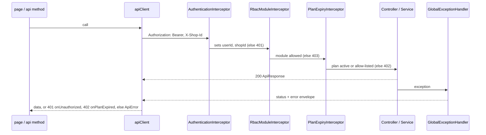
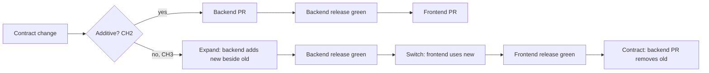

# API contract

## Purpose

- These are the rules both repositories follow for HTTP JSON between the frontend (inventory-platform) and the backend (inventory-api).
- Design agents use them to fill a design's `## Cross-repo contract` section (CH5). Reviewers cite them as "API_CONTRACT UV3".
- Per-repo rules live in [backend AGENTS.md](https://github.com/Stockkart/inventory-api/blob/main/AGENTS.md) and [frontend AGENTS.md](https://github.com/Stockkart/inventory-platform/blob/main/AGENTS.md). This file cites them by rule ID and does not repeat them.
- Each rule is one bullet. `Ex:` names one endpoint that follows it, as `VERB path` (backend file) ↔ client call (frontend file).
- Paths start with the repository: `backend/` is inventory-api, `frontend/` is inventory-platform.
- Scope: 54 `@RestController` classes, 219 mappings. Facts as of backend `ddfd9d79` and frontend `780e504`, 2026-10-17.

## URL and verb conventions

Class paths and verbs are backend AGENTS.md N4 and N5. These rules add the client side.

- UV1. The class path is `/api/v1/<kebab-plural or mass noun>`. The client base URL (`VITE_API_URL`) already ends in `/api/v1`. Constants in `core/<d>/src/api/endpoints.ts` leave the prefix out. Ex: `GET /api/v1/vendors` (`backend/core/user/src/main/java/com/inventory/user/rest/controller/VendorController.java`) ↔ `VENDOR_ENDPOINTS.BASE` (`frontend/core/user/src/api/endpoints.ts`), `vendorsApi.list` (`frontend/core/user/src/api/vendors.api.ts`).
- UV2. The client verb equals the backend verb. An update uses the verb the resource already uses (N5). Ex: `PATCH /api/v1/customers/{customerId}` (`backend/core/user/src/main/java/com/inventory/user/rest/controller/CustomerController.java`) ↔ `customersApi.update` (`frontend/core/user/src/api/customers.api.ts`).
- UV3. An action is `POST` on a sub-path: `/{id}/<action>` or `/<action>`. Never put `create`, `update`, `upsert` or `delete` in a path. Ex: `POST /api/v1/vendor-purchase-invoices/preview-totals` (`backend/core/product/src/main/java/com/inventory/product/rest/controller/VendorPurchaseInvoiceController.java`) ↔ `inventoryApi.previewPurchaseTotals` (`frontend/core/product/src/api/inventory.api.ts`).
- UV4. Every client constant matches a backend mapping. A path value that is not an ObjectId goes through `encodeURIComponent`. Ex: `POST /api/v1/barcodes/{code}/attach` (`backend/core/product/src/main/java/com/inventory/product/rest/controller/BarcodeController.java`) ↔ `BARCODE_ENDPOINTS.ATTACH` (`frontend/core/product/src/api/endpoints.ts`), `barcodesApi.attach` (`frontend/core/product/src/api/barcodes.api.ts`).
- UV5. Query values are strings. `apiClient.get` takes `Record<string, string>`, so callers wrap numbers in `String()`. Ex: `GET /api/v1/reminders?page&size` (`backend/core/reminders/src/main/java/com/inventory/reminders/rest/controller/ReminderController.java`) ↔ `remindersApi.getAll` (`frontend/core/reminders/src/api/reminders.api.ts`).

## Status codes

- SC1. Every success is 200 with an `ApiResponse<T>` body, for every verb. Controllers call `ResponseEntity.ok` 216 times and never send 201 or 204. The client resolves any 2xx, and api methods return `response.data`. Ex: `POST /api/v1/vendors` (`VendorController.java`) ↔ `vendorsApi.create`.
- SC2. Error statuses come only from `ErrorCode` through `GlobalExceptionHandler` (backend AGENTS.md E3). The client reacts in `frontend/platform/api-client/src/lib/client.ts` as below. Ex: `GET /api/v1/vendors/{vendorId}` → 404 `ResourceNotFoundException` ↔ `vendorsApi.getById` throws `ApiError`.

| Status | Backend source | Client reaction |
|---|---|---|
| 400 | `ValidationException`, `@Valid`, malformed JSON | throws `ApiError` |
| 401 | missing, invalid or expired token; no shop context (backend AGENTS.md E7) | `onUnauthorized` (`frontend/platform/shell/src/lib/AuthInitializer.tsx`) clears the session and goes to `/login`. Skipped when `isPublicAuthRequest` matches the URL. |
| 402 | `PlanExpiryInterceptor` (`ErrorCode.PLAN_EXPIRED`) | `onPlanExpired` (`frontend/platform/shell/src/guards/DashboardRouteGuard.tsx`) goes to `/dashboard/plan-status` unless `isPlanExpiryAllowedPath` |
| 403 | `ErrorCode.ACCESS_DENIED` (`RbacService`) | throws `ApiError` |
| 404 | `ResourceNotFoundException` | throws `ApiError`. Some callers map it to `null`, e.g. `customersApi.searchByPhone` on `GET /api/v1/customers/search`. |
| 409, 422, 500 | `ResourceExistsException`, `GstConfigurationException`, any other exception | throws `ApiError` |
| 0 | no response | throws `ApiError` "Network error. Please check your connection." |

- SC3. Use 401 only for "who are you". Deny access with 403 (`ErrorCode.ACCESS_DENIED`). Reason: any 401 logs the user out. Ex: `GET /api/v1/shops/{shopId}/rbac` → `RbacService.requireOwner` (`backend/core/user/src/main/java/com/inventory/user/service/RbacService.java`) ↔ `shopAccessApi.getAdmin` (`frontend/core/user/src/api/shop-access.api.ts`).
- SC4. An endpoint that must work while the plan is expired goes in `ALLOWED_PREFIXES` or `ALLOWED_PATTERNS` of `backend/app/src/main/java/com/inventory/app/interceptor/PlanExpiryInterceptor.java`. The frontend `PLAN_EXPIRY_ALLOWED_PATHS` (`frontend/platform/contracts/src/plan-guards.ts`) lists routes, not API paths. Ex: `GET /api/v1/plans/shop/status` (`backend/core/plan/src/main/java/com/inventory/plan/rest/controller/PlanController.java`) ↔ `PLAN_ENDPOINTS.SHOP_STATUS` (`frontend/core/plan/src/api/endpoints.ts`), `frontend/core/plan/src/api/plans.api.ts`.

Spring MVC framework errors return ProblemDetail (backend AGENTS.md E8). The client finds no message field there, so `ApiError.message` is the HTTP status text.

## Pagination, filtering and sorting

Counts are over the 24 endpoints that take `page`.

- PG1. `page` is 0-based (20 of 24). Ex: `GET /api/v1/inventory` (`backend/core/product/src/main/java/com/inventory/product/rest/controller/InventoryController.java`, default `0`) ↔ `inventoryApi.getAll(page = 0, size = 10)` (`frontend/core/product/src/api/inventory.api.ts`).
- PG2. The page size is `size` (18 of 24). `limit` only caps a list that has no pages: `GET /api/v1/barcodes`, `/inventory/search/values`, `/purchases/customer-product-history`. Ex: `GET /api/v1/reminders` ↔ `remindersApi.getAll(page, size)`.
- PG3. A paged response carries `page`, `size`, `totalItems` and `totalPages`. Each name is the majority (`totalItems` 16, `totalPages` 20 of 24). New endpoints nest them as `PageMeta` under the key `page`. The frontend type is `PageMeta` in `frontend/platform/contracts/src/notification.types.ts`. Ex: `GET /api/v1/inventory` → `InventoryListResponse.page` ↔ `PaginationInventoryResponse.page: PageMeta` (`frontend/core/product/src/model/types.ts`).
  - Backend copies: `backend/core/product/src/main/java/com/inventory/product/rest/dto/response/PageMeta.java` and `backend/core/reminders/src/main/java/com/inventory/reminders/rest/dto/response/PageMeta.java`. A module with no pom edge to product (backend AGENTS.md L1) copies the 4-field class.
  - Flat fields (accounting, credit) and the key `meta` (reminders) also exist. They follow PG3.
- PG4. The free-text filter is `q`. Ex: `GET /api/v1/vendors?q=` ↔ `vendorsApi.list({ q })`.
- PG5. A date range is `from` and `to`, ISO dates `yyyy-MM-dd` (`@DateTimeFormat(iso = DATE)`, 34 uses). A single day is `asOf`. A GST month is `period` as `YYYY-MM`. Ex: `GET /api/v1/accounting/reports/profit-and-loss` (`backend/core/accounting/src/main/java/com/inventory/accounting/rest/controller/AccountingController.java`) ↔ `accountingApi.profitAndLoss(from, to)` (`frontend/core/accounting/src/api/accounting.api.ts`).
- PG6. A multi-value filter is one comma-separated parameter. Ex: `txnTypes` on `GET /api/v1/mis/customer-money` (split in `backend/core/analytics/src/main/java/com/inventory/analytics/mis/service/CustomerMoneyMisService.java`) ↔ `join(',')` (`frontend/core/mis/src/api/mis.api.ts`).
- PG7. Sort is `sort=<field>:<asc|desc>` (1 of the 2 sorting endpoints). The server allow-lists the fields and sets the default. The body field `sort` of `POST /api/v1/inventory/search` uses the same format. Ex: `GET /api/v1/inventory/search` (`backend/core/product/src/main/java/com/inventory/product/utils/InventorySearchQueryParser.java`, `backend/core/product/src/main/java/com/inventory/product/search/SearchRequestValidator.java`) ↔ `queryParams.sort` in `inventoryApi.search`.

## Formats (dates, money, IDs, enums)

- FM1. Dates use Jackson defaults. `Instant` is an ISO-8601 UTC string. `LocalDate` is `yyyy-MM-dd`. Main code has no `spring.jackson.*` property, no `ObjectMapper` bean and no `@JsonFormat`. The frontend types dates as `string`. Ex: `ReminderResponse.reminderAt` (`Instant`) on `GET /api/v1/reminders` ↔ `Reminder.reminderAt: string` (`frontend/core/reminders/src/model/types.ts`).
- FM2. Money is `BigDecimal` in DTOs (578 fields) and a JSON number on the wire. The frontend types it as `number`. The server computes totals and tax; the client displays them (`backend/README.md`, "Previewing a bill before stock-in"). Ex: `POST /api/v1/vendor-purchase-invoices/preview-totals` → `backend/core/product/src/main/java/com/inventory/product/rest/dto/response/PurchaseTaxPreviewResponse.java` ↔ `PurchaseTaxPreviewResponse` (`frontend/core/product/src/model/types.ts`).
  - The GSTR-1 offline-return file (`Gstr1PortalReturnDto`) follows the GST portal's JSON schema by design.
- FM3. IDs are opaque strings. Generated document IDs are 24-hex Mongo ObjectIds. The interceptors match shop and plan IDs in paths with `[a-fA-F0-9]{24}`. The client never parses or builds an ID. Embedded line IDs are UUIDs (shop menu, stock-correction lines). Ex: `GET /api/v1/vendors/{vendorId}` ↔ `vendorsApi.getById`.
- FM4. An enum travels as the Java constant name (UPPER_SNAKE). The frontend mirrors it as a same-named string union with every value. Ex: `AccountType` (`backend/core/accounting/src/main/java/com/inventory/accounting/domain/model/AccountType.java`) on `GET /api/v1/accounting/accounts` ↔ `AccountType` (`frontend/core/accounting/src/model/types.ts`), `accountingApi.accounts`.
  - Lower-case wire names by design:
    - the 9 product search and label enums with `@JsonValue` (`backend/core/product/src/main/java/com/inventory/product/search/FilterOp.java` and its siblings) ↔ `FilterOp` (`frontend/core/product/src/model/search.types.ts`);
    - `ShopSchemaResponse.mode`, lower-cased in `backend/core/product/src/main/java/com/inventory/product/service/vertical/VerticalSchemaService.java`;
    - `MenuSellMode`, whose constants are lower-case.
- FM5. `ApiResponse`, `ApiError` and 7 DTOs in use omit null fields (`@JsonInclude(NON_NULL)`). Other DTOs send `null`. Type an optional field as `?: T | null` either way. The backend ignores unknown request fields (Spring Boot Jackson default). Ex: `taxTreatmentSource` in `PurchaseTaxPreviewResponse` ↔ `taxTreatmentSource?: … | null`.

## Error response shape

- Producer: `backend/core/common/src/main/java/com/inventory/common/advice/GlobalExceptionHandler.java`. It puts an `ApiError` (`backend/core/common/src/main/java/com/inventory/common/dto/response/ApiError.java`, built by `ApiErrorMapper.java`) into `data` of `ApiResponse.error(message)` (`backend/core/common/src/main/java/com/inventory/common/dto/response/ApiResponse.java`). Full JSON: backend AGENTS.md E2.
- Consumer: the response interceptor in `frontend/platform/api-client/src/lib/client.ts`. It throws `ApiError` (`frontend/platform/api-client/src/lib/ApiError.ts`). Callers test with `isApiError`.

| Wire field | Sent | Client reads it as |
|---|---|---|
| `data.message` | always | `ApiError.message`, first choice |
| `error` | always | `ApiError.message`, second choice |
| `data.status` | always | not read; `ApiError.status` is the HTTP status |
| `data.errors` | validation failures only | not read; the client reads a top-level `errors`, so `ApiError.errors` is always undefined |
| `code` | never (`ErrorCode.code` is not serialized) | `ApiError.code` is always undefined |
| ProblemDetail `detail` | Spring MVC errors (E8) | not read; the message falls back to the status text |

- ER1. Throw from the service or validator, and let `GlobalExceptionHandler` build the body. Never build `ApiResponse.error` in a controller. Ex: `POST /api/v1/vendors`: `VendorValidator` (`backend/core/user/src/main/java/com/inventory/user/validation/VendorValidator.java`) throws `ValidationException` → 400 ↔ `vendorsApi.create` rejects with `ApiError.message`.
- ER2. Show `ApiError.message`. For a `ValidationException` it already joins the messages with "; ". Do not depend on `ApiError.errors` or `ApiError.code` while `client.ts` reads them from the top level. Ex: `isApiError(err) && err.status === 400` for `GET /api/v1/inventory` (`frontend/core/product/src/api/inventory.api.ts`).
- ER3. Use `ApiError` and `isApiError` from `@inventory-platform/api-client`. The `ApiError` interface and `PaginatedResponse` in `frontend/platform/contracts/src/index.ts` are unused and match no endpoint. Ex: `frontend/core/product/src/api/inventory.api.ts` imports `isApiError` for `GET /api/v1/inventory`.

Blob downloads get the error body as a `Blob` and skip this mapping (the download helpers in frontend AGENTS.md "State and data fetching").

## Authentication and authorization between frontend and backend



- AU1. `POST /api/v1/auth/login` and `/signup` return `accessToken`. It is an opaque UUID that lives 7 days, stored in `UserAccount.tokens` (`backend/core/user/src/main/java/com/inventory/user/mapper/UserMapper.java`). The client stores it in localStorage `auth_token` and sends `Authorization: Bearer`. A `refreshToken` is returned, but no refresh endpoint exists. Ex: `backend/core/user/src/main/java/com/inventory/user/rest/controller/AuthController.java` ↔ `authApi.login` (`frontend/platform/session/src/api/auth.api.ts`).
- AU2. Every `apiClient` call sends `X-Shop-Id` from localStorage `x_shop_id`, which `useAuthStore` sets. The backend uses it if the user is a member. Otherwise it silently uses the active shop (backend AGENTS.md L6). Ex: `POST /api/v1/users/me/active-shop` (`backend/core/user/src/main/java/com/inventory/user/rest/controller/UserShopController.java`) ↔ `useAuthStore.switchActiveShop` (`frontend/platform/session/src/lib/useAuthStore.ts`).
- AU3. Register a public path in both backend lists (backend AGENTS.md X3). Add a public auth route to `isPublicAuthRequest` in `client.ts` too, so a 401 there does not log the user out. Ex: `POST /api/v1/auth/forgot-password` (`AuthController.java`) ↔ `AUTH_ENDPOINTS.FORGOT_PASSWORD` (`frontend/platform/session/src/api/endpoints.ts`).
- AU4. The backend enforces RBAC (backend AGENTS.md L7; `RbacModuleInterceptor`, `RbacService` → 403). The frontend only hides UI. Module keys are the `RbacService.MODULE_*` strings. A new module key or capability changes both sides in one design. Ex: `GET /api/v1/shops/me/access` → `backend/core/user/src/main/java/com/inventory/user/rest/dto/response/ShopAccessResponse.java` ↔ `ShopAccess` (`frontend/platform/access/src/shop-access.ts`); `GET /api/v1/shops/me/capabilities` → `backend/pluginengine/src/main/java/com/inventory/pluginengine/capabilities/ShopUiCapabilities.java` ↔ `frontend/platform/access/src/shop-capabilities.ts`.
- AU5. Tenant scope is the header shop (AU2). A `{shopId}` path is only for cross-shop team, RBAC or plan actions. The server checks membership or ownership of that shop before use. Ex: `GET /api/v1/shops/{shopId}/rbac` → `RbacService.requireOwner` ↔ `shopAccessApi.getAdmin`.
- AU6. Some calls bypass the `apiClient` interceptors. Ex: `GET /api/v1/events/stream` (`backend/core/reminders/src/main/java/com/inventory/reminders/rest/controller/EventController.java`) ↔ `apiClient.createSseConnection` (`frontend/platform/shell/src/api/events.api.ts`).
  - SSE sends only `Authorization`.
  - Blob downloads (`frontend/core/*/src/api/download.ts`) send both headers but get no 401 or 402 handling.
  - `/m/**` takes an upload token as a query parameter and allows any origin (`backend/app/src/main/java/com/inventory/app/config/CorsConfig.java`).
  - CORS on `/api/**` allows the origin in property `client.url` (env `CLIENT_URL`) and any header.

## Changing a contract



- CH1. Backend first. Merge the backend PR, wait until its release run is green, then merge the frontend PR (`backend/docs/deploying.md`, `frontend/docs/deploying.md`). A merge to `main` ships to production; the normal release has no approval step.
- CH2. So every backend change must also serve the frontend that is live. These changes are additive and safe: a new endpoint, a new optional request field, a new response field (FM5).
- CH3. These changes are breaking: renaming or removing a field; changing a type, format, nullability, path, verb, status or page base; a new required request field; a new enum value the client switches on; moving an endpoint behind RBAC or plan expiry. Ship a breaking change as expand → switch → contract, in three PRs (diagram).
- CH4. The frontend PR changes three things together: the type in `core/<d>/src/model/` (or `platform/contracts` for shared types), the constant in `endpoints.ts`, and the method in `<name>Api` (frontend AGENTS.md "State and data fetching"). Name the TS type after the backend DTO, as `PurchaseTaxPreviewResponse` does. The backend PR updates the README endpoint tables (backend AGENTS.md X4) and the access lists (A9).
- CH5. A multi-repo design's `## Cross-repo contract` section has one block per endpoint: a 2-column table (Item | Value) with these rows.
  - Endpoint: verb and full path.
  - Change class: new, additive, or breaking with the CH3 steps.
  - Request: query parameters and body fields, typed per FM1–FM5.
  - Response: `ApiResponse<T>` and the fields of `T`.
  - Errors: status → cause.
  - Access: public, RBAC module, plan-expiry allow-list.
  - Backend files: controller, DTOs.
  - Frontend files: constant, api method, type.
  - Merge order (CH1).
  - Deviations: rule ID and reason.
- CH6. New code follows these rules. Do not add rows to the table below. When a fix lands, remove its row in a handbook PR.

## Non-compliant endpoints today

Rows come from the commands under the table or from the one-off scan noted after them. The table is complete for those checks only. FM4 compares same-named unions only; inline or renamed unions are not checked.

| Endpoint | Rule broken | Path |
|---|---|---|
| `POST /api/v1/session/create-upload-token`, `GET /api/v1/upload/status`, `GET /api/v1/upload/parsed-items`, `/m/upload/**` | UV1 no class path, singular nouns; UV3 verb in path | `backend/core/product/src/main/java/com/inventory/product/rest/controller/QRUploadController.java` |
| `/api/v1/shops/{shopId}/users/**` | UV1 bare `@RequestMapping` | `backend/core/user/src/main/java/com/inventory/user/rest/controller/ShopUserController.java` |
| `/api/v1/cart/**`, `/api/v1/estimates/**`, `/api/v1/purchases/**` | UV1 class path is bare `/api/v1` | `backend/core/product/src/main/java/com/inventory/product/rest/controller/CheckoutController.java` |
| `/api/v1/shops/{shopId}/invitations`, `/api/v1/invitations/{invitationId}/accept`, `/api/v1/users/invitations`, `/api/v1/shops/{shopId}/users/all` | UV1 bare `/api/v1` | `backend/core/user/src/main/java/com/inventory/user/rest/controller/InvitationController.java` |
| `/api/v1/shops/by-owner-email`, `/api/v1/shops/join-request`, `/api/v1/shops/join-requests/**` | UV1 bare `/api/v1` | `backend/core/user/src/main/java/com/inventory/user/rest/controller/JoinRequestController.java` |
| `/api/v1/refund/**` | UV1 singular noun | `backend/core/product/src/main/java/com/inventory/product/rest/controller/RefundController.java` |
| `POST /api/v1/cart/upsert` | UV3 | `backend/core/product/src/main/java/com/inventory/product/rest/controller/CheckoutController.java` |
| `POST /api/v1/pricing/bulk-update` | UV3 | `backend/core/pricing/src/main/java/com/inventory/pricing/rest/controller/PricingController.java` |
| `GET`, `PATCH /api/v1/shops/{shopId}` | UV4 no backend mapping; the shop edit modal calls `shopsApi.getShop` on open and `updateShop` on save | `frontend/core/user/src/api/shops.api.ts`, `frontend/platform/shell/src/lib/DashboardLayout.tsx` |
| `POST /api/v1/checkout`, `POST /api/v1/auth/refresh`, `POST /api/v1/auth/accept-invite` | UV4 no backend mapping; `checkoutApi.create`, `refreshToken`, `acceptInvite` have no caller | `frontend/core/product/src/api/checkout.api.ts`, `frontend/platform/session/src/api/auth.api.ts` |
| `POST /api/v1/inventory/bulk` | ER1 returns `ApiResponse.error` 400 with no `data` | `backend/core/product/src/main/java/com/inventory/product/rest/controller/InventoryController.java` |
| `POST /m/upload` | ER1 builds its own 400 and 500; the 500 body carries the exception message | `backend/core/product/src/main/java/com/inventory/product/rest/controller/QRUploadController.java` |
| `POST`, `GET /api/v1/shops/{shopId}/invitations`; `GET /api/v1/shops/{shopId}/users/all` | SC3 401 on denied access | `backend/core/user/src/main/java/com/inventory/user/rest/controller/InvitationController.java` |
| `GET`, `PATCH`, `DELETE /api/v1/shops/{shopId}/users/**` | SC3 401 on denied access | `backend/core/user/src/main/java/com/inventory/user/rest/controller/ShopUserController.java` |
| `PUT /api/v1/shops/active-shop/card-layouts/{surfaceId}`, `PUT /api/v1/shops/active-shop/barcode-label-layout` | ER2 the client reads top-level `errors`; the backend sends `data.errors` | `frontend/platform/api-client/src/lib/client.ts`, `frontend/core/product/src/ui/cardLayout/ProductCardLayoutSection.tsx`, `frontend/core/product/src/ui/labelLayout/BarcodeLabelLayoutSection.tsx` |
| `GET /api/v1/purchases`, `/purchases/search`, `/refund`, `/vendor-purchase-returns` | PG1 1-based; PG2 `limit`; PG3 `limit`/`total` | `backend/core/product/src/main/java/com/inventory/product/service/CheckoutService.java`, `backend/core/product/src/main/java/com/inventory/product/service/RefundService.java`, `backend/core/product/src/main/java/com/inventory/product/service/VendorPurchaseReturnService.java`, `backend/core/product/src/main/java/com/inventory/product/rest/dto/response/PurchaseListResponse.java`, `backend/core/product/src/main/java/com/inventory/product/rest/dto/response/RefundListResponse.java`, `backend/core/product/src/main/java/com/inventory/product/rest/dto/response/VendorPurchaseReturnListResponse.java` |
| `GET /api/v1/customers`, `/vendors` | PG2 `limit`; PG3 `limit`/`total` | `backend/core/user/src/main/java/com/inventory/user/rest/dto/response/CustomerListResponse.java`, `backend/core/user/src/main/java/com/inventory/user/rest/dto/response/VendorListResponse.java` |
| `GET /api/v1/estimates`, `/stock-entry-estimates` | PG3 `total` instead of `totalItems` | `backend/core/product/src/main/java/com/inventory/product/rest/dto/response/EstimateListResponse.java`, `backend/core/product/src/main/java/com/inventory/product/rest/dto/response/StockEntryEstimateListResponse.java` |
| `GET /api/v1/mis/customer-money`, `/sales`, `/stock`, `/vendor-money` | PG3 no `totalPages` | `backend/core/analytics/src/main/java/com/inventory/analytics/mis/rest/dto/Mis*ReportResponse.java` |
| `GET /api/v1/inventory/lots` | PG4 `search` instead of `q` | `backend/core/product/src/main/java/com/inventory/product/rest/controller/InventoryController.java` |
| `GET /api/v1/analytics/customers`, `/profit`, `/sales`, `/vendors` | PG5 `startDate`/`endDate` as `Instant` | `Customer`, `Profit`, `Sales`, `VendorAnalyticsController.java` in `backend/core/analytics/src/main/java/com/inventory/analytics/rest/controller/` |
| `GET /api/v1/purchases` | PG7 `order` instead of `sort` | `backend/core/product/src/main/java/com/inventory/product/rest/controller/CheckoutController.java` |
| `GET /api/v1/taxation/gstr3b` | FM2 money as `Double` (40 fields) | `backend/core/taxation/src/main/java/com/inventory/taxation/rest/dto/Gstr3bReportResponse.java` |
| `GET /api/v1/reminders` (`status`) | FM4 union lacks `SENT`, `CANCELLED`, `SNOOZED` | `frontend/core/reminders/src/model/types.ts`, `frontend/platform/contracts/src/notification.types.ts` |
| `GET /api/v1/accounting/journal-entries` (`sourceType`) | FM4 union lacks `VENDOR_CREDIT_CHARGE`, `CUSTOMER_CREDIT_CHARGE` | `frontend/core/accounting/src/model/types.ts` |
| `GET /api/v1/shops/{shopId}/users/all` (`role`) | FM4 `UserRole` lacks `OWNER`; `ShopUsersList.tsx` casts to it | `frontend/core/user/src/model/party.types.ts` |
| `POST /api/v1/shops/admin/shops/{shopId}/approve` | AU5 no admin or owner check in the controller, service or validator | `backend/core/product/src/main/java/com/inventory/product/rest/controller/ShopController.java`, `backend/core/product/src/main/java/com/inventory/product/service/ShopService.java` |
| `GET /api/v1/plans/shop/{shopId}/suggested`, `POST /api/v1/plans/shop/{shopId}/assign` | AU5 no membership check on the path shop; RBAC checks the header shop | `backend/core/plan/src/main/java/com/inventory/plan/rest/controller/PlanController.java` |
| `/api/v1/auth/accept-invite`, `/api/product/get-plugin`, `/api/product/` | AU3 public-list entries with no controller | `backend/app/src/main/java/com/inventory/app/interceptor/AuthenticationInterceptor.java`, `backend/app/src/main/java/com/inventory/app/config/CorsConfig.java` |
| `GET /api/v1/events/stream` | AU2 no `X-Shop-Id`; the backend uses the active shop | `frontend/platform/api-client/src/lib/client.ts` |

Excluded after triage: non-JSON returns (files, text, SSE; backend AGENTS.md E1), `Gstr1PortalReturnDto` (portal schema), `SchemaDisplayMode` (lower-cased on the wire), the unused `ACCOUNTING_ENDPOINTS.BASE`, `ANALYTICS_ENDPOINTS.BASE` and `CREDIT_ENDPOINTS.BASE`, and the `{shopId}` endpoints that do check (invitations, `users/**`, `rbac/**`).

Regenerate from the workspace root (one directory holding `backend/` and `frontend/`):

```sh
grep -L '@RequestMapping("/api/v1/[a-z]' $(grep -rlw '@RestController' --include=*.java backend)  # UV1
grep -rhoE '@RequestMapping\("/api/v1/[a-z-]+' --include=*Controller.java backend | sort -u  # UV1 nouns
grep -rnoE 'Mapping\((value *= *)?"[^"]*(create|update|upsert|delete)[^"]*"' --include=*Controller.java backend  # UV3
grep -rn 'ApiResponse.error\|ResponseEntity.status\|badRequest()' --include=*Controller.java backend  # ER1
grep -rn -A2 '!.*has\(Owner\)\?Access(' --include=*Controller.java backend | grep AuthenticationException  # SC3
grep -rl 'page - 1' backend/core  # PG1
grep -rn 'Integer limit' --include=*Controller.java backend  # PG2, minus the 3 capped lists
grep -rlE 'private (double|Double) ' --include=*.java backend/core | grep /dto/  # FM2
grep -rl '@JsonInclude' --include=*.java backend/core | grep -v /test/  # FM5
```

The other rows (UV4, PG3–PG7, FM4, AU2, AU3, AU5, ER2) come from a one-off cross-repo scan. UV4 diffs `*_ENDPOINTS` constants against backend mappings. FM4 diffs same-named TS unions against Java enums. Where these checks live is open for `decisions/`.
