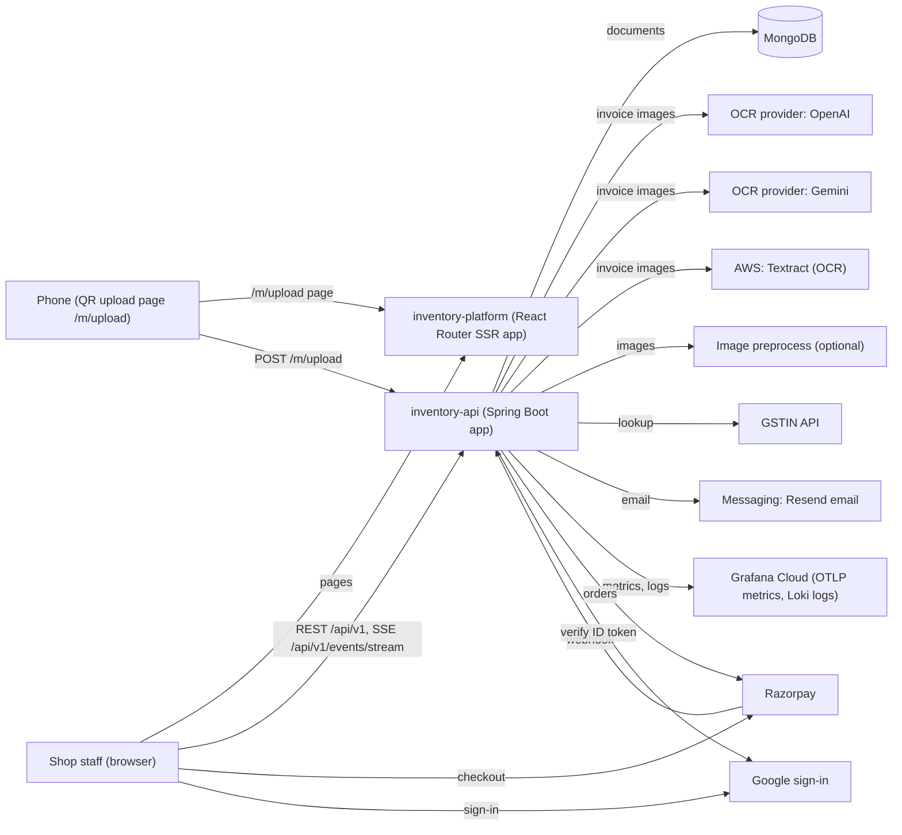
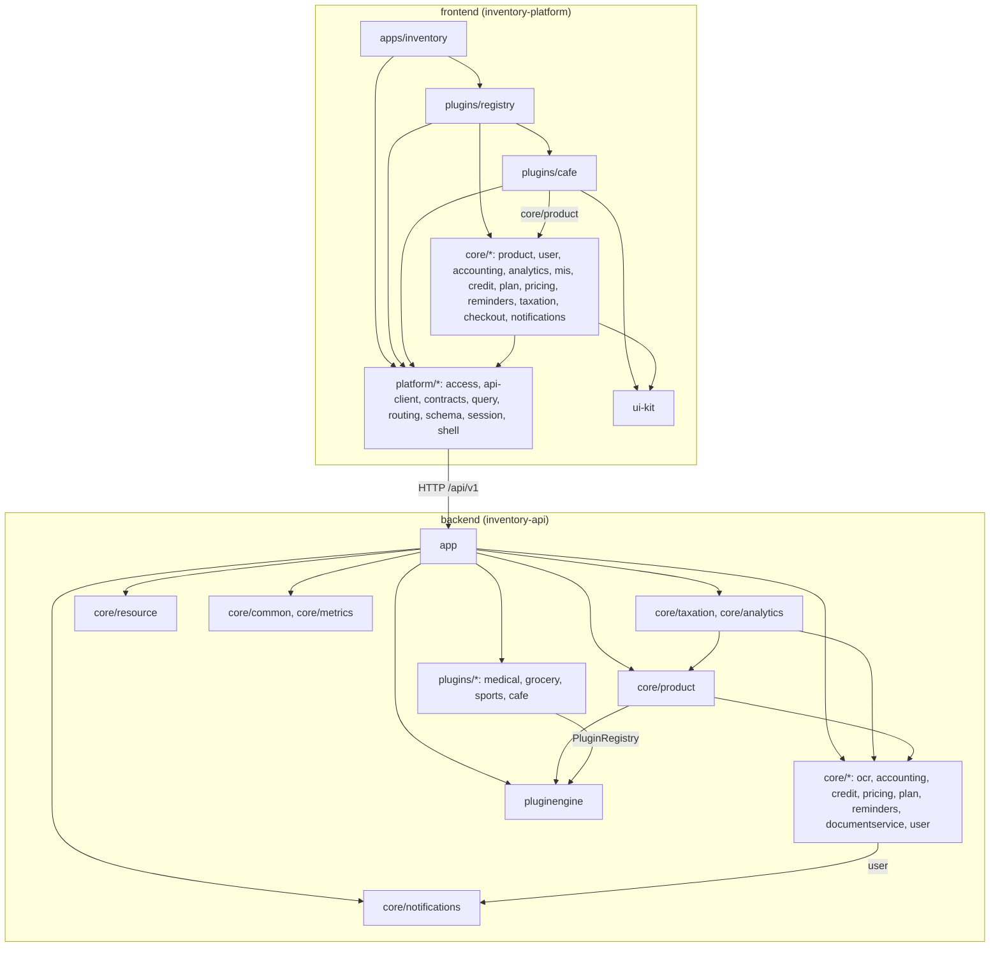
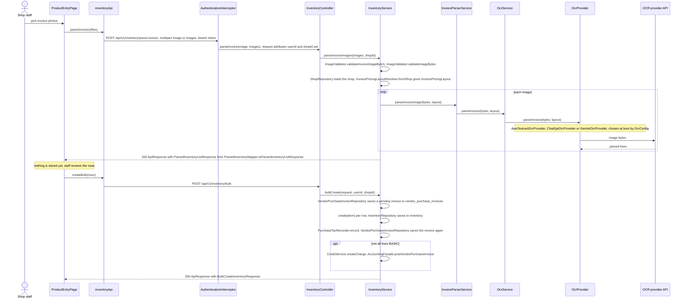

# Stockkart Architecture

## Purpose

- Stockkart is shop inventory software: stock, billing, GST returns, accounting, plans and OCR invoice parsing.
- It has two repositories: inventory-api (backend) and inventory-platform (frontend).
- This page is for design and review agents. It covers the seams between the two repositories.
- `backend/` is the inventory-api repository root; `frontend/` is the inventory-platform repository root.
- Per-repository rules: [backend AGENTS.md](https://github.com/Stockkart/inventory-api/blob/main/AGENTS.md), [frontend AGENTS.md](https://github.com/Stockkart/inventory-platform/blob/main/AGENTS.md).

## System context

Sources: `frontend/apps/inventory/react-router.config.ts`, `backend/app/src/main/java/com/inventory/app/AppApplication.java`, `backend/core/ocr/src/main/java/com/inventory/ocr/provider/impl/`, `backend/core/ocr/src/main/java/com/inventory/ocr/preprocess/`, `backend/core/ocr/pom.xml`, `backend/core/taxation/src/main/java/com/inventory/taxation/gstin/GstinApiInLookupProvider.java`, `backend/core/notifications/src/main/java/com/inventory/notifications/adapter/ResendEmailAdapter.java`, `backend/core/plan/src/main/java/com/inventory/plan/payment/razorpay/RazorpayApiClient.java`, `frontend/core/plan/src/payment/razorpayScript.ts`, `frontend/apps/inventory/app/root.tsx`, `backend/core/user/src/main/java/com/inventory/user/externalservice/GoogleTokenVerifier.java`, `backend/app/src/main/java/com/inventory/app/observability/GrafanaCloudOtlpConfiguration.java`, `backend/app/src/main/resources/logback-spring.xml`.

- The SSR server makes no backend calls. Only `frontend/apps/inventory/app/routes/favicon.tsx` and `frontend/apps/inventory/app/routes/well-known-chrome-devtools.tsx` export a `loader`. All API calls come from the browser.
- The phone page is `mobileUploadRoutes` in `frontend/core/product/src/routes.ts`. It posts to the backend through `VITE_MOBILE_API_URL` (`frontend/core/product/src/api/upload.api.ts`).
- AWS is used only for Textract.

## Components

- Edges show the main direction only. `backend/core/common` and `backend/core/metrics` are used by all backend modules. `backend/core/resource` is used by `backend/app` only.
- Sources: each `pom.xml` (e.g. `backend/core/taxation/pom.xml`, `backend/core/analytics/pom.xml`, `backend/core/user/pom.xml`, `backend/app/pom.xml`); imports in `frontend/plugins/cafe/src`, `frontend/plugins/registry/src`, `frontend/apps/inventory/app`.
- Full matrices: backend AGENTS.md, Layering and module boundaries; frontend AGENTS.md, Nx workspace structure and project boundaries.

## Main flow

Invoice photo to stored purchase (desktop path).
Participants are the ten declared below. Other classes appear only in message or Note text.

Sources: `frontend/core/product/src/pages/ProductEntryPage.tsx`, `frontend/core/product/src/api/inventory.api.ts`, `backend/core/product/src/main/java/com/inventory/product/rest/controller/InventoryController.java`, `backend/core/product/src/main/java/com/inventory/product/service/InventoryService.java` (`parseInvoiceImages`, `bulkCreate`, `postCreditAndAccountingForVendorInvoice`), `backend/core/ocr/src/main/java/com/inventory/ocr/service/InvoiceParserService.java`, `backend/core/ocr/src/main/java/com/inventory/ocr/service/OcrService.java`, `backend/core/ocr/src/main/java/com/inventory/ocr/provider/OcrProvider.java`.

- The full interceptor chain is in backend AGENTS.md L7. The diagram shows only `AuthenticationInterceptor`.
- Phone path: `QRUploadController` (`/m/upload`) → `QRUploadService` → `InventoryService.parseInvoiceImagesFromBytes` on `ocrTaskExecutor` (`backend/app/src/main/java/com/inventory/app/config/AsyncExecutorConfiguration.java`). It stores `ParsedInventoryResult` and tracks `UploadToken`. The desktop polls `/api/v1/upload/status` and reads `/api/v1/upload/parsed-items`, which deletes the result.
- Spreadsheet path: `/api/v1/inventory/parse-stock-sheet` → `InventoryService.parseStockSheet`, then the same bulk create (`frontend/core/product/src/pages/ImportPage.tsx`).

## What lives where

| Capability | Backend (inventory-api) | Frontend (inventory-platform) |
|---|---|---|
| Login, signup, tokens | `backend/core/user` (`AuthController`, `TokenValidationService`) | `frontend/core/user/src/journey/auth`, `frontend/platform/session` |
| Request auth, tenant, RBAC, plan expiry | `backend/app/src/main/java/com/inventory/app/interceptor/` | `frontend/platform/api-client` (headers, 401/402), `frontend/platform/access` |
| Shops: register, active shop, schema, capabilities | `backend/core/product` (`ShopController`) | `frontend/platform/session` (`/shops/me/schema`, `/shops/me/capabilities`), `frontend/core/user` (shops) |
| Shop members, roles | `backend/core/user` (`ShopRbacController`, `InvitationController`, `JoinRequestController`) | `frontend/core/user` |
| Customers, vendors | `backend/core/user` | `frontend/core/user` |
| Inventory, stock-in, purchase invoices, returns | `backend/core/product` | `frontend/core/product` |
| Invoice OCR | `backend/core/ocr`; entry in `backend/core/product` (`InventoryController`, `QRUploadController`) | `frontend/core/product` (`ProductEntryPage`, `frontend/core/product/src/routes/mobile-upload.tsx`) |
| Checkout, sales invoices, refunds | `backend/core/product` (`CheckoutController`, `InvoiceController`, `RefundController`) | `frontend/core/product` (`frontend/core/checkout` is a scaffold) |
| Pricing | `backend/core/pricing` | `frontend/core/pricing` |
| Accounting | `backend/core/accounting` | `frontend/core/accounting` |
| Credit | `backend/core/credit` | `frontend/core/credit` |
| Analytics, MIS | `backend/core/analytics` | `frontend/core/analytics`, `frontend/core/mis` |
| GST returns | `backend/core/taxation` | `frontend/core/taxation` |
| GSTIN lookup | `backend/core/taxation/src/main/java/com/inventory/taxation/gstin/`; offline check `backend/core/common/src/main/java/com/inventory/common/gst/Gstin.java` | `frontend/core/user/src/api/endpoints.ts`, `frontend/core/user/src/model/gstin.ts` |
| Plans, payments | `backend/core/plan` | `frontend/core/plan` |
| Reminders, live events (SSE) | `backend/core/reminders` (`ReminderController`, `EventController`) | `frontend/core/reminders`, `frontend/platform/shell` (`useNotifications`) |
| Outbound email | `backend/core/notifications` | none (`frontend/core/notifications` is a scaffold) |
| Printing, documents | `backend/core/product` (`PrintJobController`, `PrintBridgeController`), `backend/core/documentservice` | `frontend/core/product/src/api/print.api.ts` |
| Tutorials | `backend/core/resource` | `frontend/platform/shell` |
| Verticals | `backend/pluginengine`, `backend/plugins/*`, seeds `backend/core/product/src/main/resources/seeds/` | `frontend/platform/schema`, `frontend/plugins/registry`, `frontend/plugins/cafe` |
| Metrics, logs | `backend/core/metrics`, `backend/app/src/main/java/com/inventory/app/observability/` | none |
| Design system | none | `frontend/ui-kit` |

## Boundaries

Frontend may assume about backend:
- B1. All JSON endpoints sit under `/api/v1` and return `ApiResponse` (`success`, `data`, `message`, `error`). Error shapes: backend AGENTS.md E2, E8. Ref: `backend/core/common/src/main/java/com/inventory/common/dto/response/ApiResponse.java`, mirrored by `frontend/platform/contracts/src/index.ts`.
- B2. The bearer token is opaque. The backend looks it up per request (`TokenValidationService` → `UserAccountRepository.findByAccessToken`). Ref: `backend/app/src/main/java/com/inventory/app/interceptor/AuthenticationInterceptor.java`.
- B3. `X-Shop-Id` selects the shop only if the user is a member. Otherwise the backend uses the active shop. Ref: `backend/app/src/main/java/com/inventory/app/interceptor/AuthenticationInterceptor.java`.
- B4. 401 means re-login. 402 means the plan expired (`PlanExpiryInterceptor`). Ref: `frontend/platform/api-client/src/lib/client.ts`.
- B5. Vertical fields and shop capabilities come from the backend (`/api/v1/verticals/{verticalId}/schema`, `/api/v1/shops/me/schema`, `/api/v1/shops/me/capabilities`). Ref: `frontend/platform/session/src/api/endpoints.ts`.

Backend may assume about frontend:
- B6. One browser origin (`CLIENT_URL`) for `/api/**` and `/admin/**`. `/m/**` allows any origin. Ref: `backend/app/src/main/java/com/inventory/app/config/CorsConfig.java`.
- B7. The frontend serves `/m/upload`, which reads a `token` query parameter. The backend builds that link from `client.url`. Ref: `backend/core/product/src/main/java/com/inventory/product/utils/UploadTokenUtil.java`, `frontend/plugins/registry/src/public-routes.ts`.

Logic and validation:
- B8. Domain rules (pricing, tax, stock, accounting, plan) are computed in backend services and plugins. Example: purchase totals come from `/api/v1/vendor-purchase-invoices/preview-totals` (`previewPurchaseTotals` in `frontend/core/product/src/api/inventory.api.ts`). The frontend keeps input, print and display logic in `lib/` and `model/`, e.g. `frontend/core/product/src/lib/inventoryAvailability.ts`, `frontend/core/product/src/lib/printBridge.ts`. Ref: `backend/core/product/src/main/java/com/inventory/product/service/InventoryService.java`.
- B9. The backend validates every input and trusts no frontend check. Validators: backend AGENTS.md E6. Images: `ImageValidator`. Ref: `backend/core/product/src/main/java/com/inventory/product/validation/ImageValidator.java`.
- B10. The frontend validates only for early feedback, and mirrors a backend rule when it does. Ref: `frontend/core/user/src/model/gstin.ts` mirrors `backend/core/common/src/main/java/com/inventory/common/gst/Gstin.java`.
- B11. Tenant scope comes from the request, never the body (backend AGENTS.md L6). The frontend never sends `shopId` to scope a call. Ref: `frontend/platform/api-client/src/lib/client.ts`.

## Runtime

| Part | Build | Run | Port | Source |
|---|---|---|---|---|
| Backend | `mvn -pl app -am clean package -DskipTests` in a Maven 3.9 / Temurin 21 image | `java -jar` on `app.jar` | 8080 | `backend/Dockerfile`, `backend/docker-compose.yml` |
| Image preprocess | not in repo | commented-out compose service | 8081 | `backend/docker-compose.yml` |
| MongoDB | external | commented-out compose service | 27017 | `backend/docker-compose.yml` |
| Frontend dev | `pnpm install` | `nx dev inventory` | 4200 (preview 4300); host port `INVENTORY_PLATFORM_PORT` | `frontend/apps/inventory/vite.config.mts`, `frontend/Dockerfile.dev`, `frontend/docker-compose.yml` |
| Frontend prod image | `nx build inventory` | `react-router-serve` | 3000 | `frontend/Dockerfile` |
| Frontend deployed | `vercel build` | Vercel | none | `frontend/scripts/deploy/vercel-deploy.sh` |

- Each repo has its own compose file. Neither runs the whole stack.
- Backend compose runs `app` only. Frontend compose runs `inventory-platform` only; its `inventory-server` service is commented out.
- Deploy targets and order: `backend/docs/deploying.md`, `frontend/docs/deploying.md`.
- Backend health: GET `/actuator/health`. GET `/commit.txt` works only in the Docker image; `backend/Dockerfile` writes the file.
- Frontend build id: a `build-sha` meta tag from `VITE_BUILD_SHA` (`frontend/apps/inventory/app/root.tsx`).
- Env var purposes are in each AGENTS.md (Configuration and environment variables; State and data fetching).

| From → to | Protocol | Env var names | Read in |
|---|---|---|---|
| Browser → backend | HTTPS REST, SSE | `VITE_API_URL`, `VITE_MOBILE_API_URL` | `frontend/platform/api-client/src/lib/client.ts`, `frontend/core/product/src/api/upload.api.ts` |
| Backend → browser origin (CORS, links) | none | `CLIENT_URL` | `CorsConfig`, `UploadTokenUtil` |
| Backend → MongoDB | Mongo driver | `DB_URI` | `backend/app/src/main/resources/application.properties` |
| Backend → OCR | HTTPS, AWS SDK | `OCR_PROVIDER`, `OCR_OPENAI_MODEL`, `OCR_GEMINI_MODEL`, `OPENAI_API_KEY`, `GEMINI_API_KEY`, `AWS_ACCESS_KEY`, `AWS_SECRET_ACCESS`, `AWS_REGION` | `OcrConfig` |
| Backend → preprocess | HTTP or subprocess | `OCR_PREPROCESS_MODE`, `OCR_PREPROCESS_URL`, `OCR_PREPROCESS_PYTHON_PATH`, `OCR_PREPROCESS_WORKING_DIR` | `OcrConfig` |
| Backend → GSTIN API | HTTPS | `GSTIN_PROVIDER`, `GSTINAPI_KEY`, `GSTINAPI_BASE_URL` | `GstinProviderConfig` |
| Backend → Resend | HTTPS | `MESSAGING_EMAIL_ENABLED`, `MESSAGING_DISPATCH_INTERVAL_MS`, `RESEND_API_KEY`, `RESEND_FROM_EMAIL`, `RESEND_FROM_NAME` | `MessageQueueProcessor`, `ResendEmailAdapter` |
| Backend ↔ Razorpay | HTTPS, webhook | `PAYMENT_GATEWAY`, `RAZORPAY_KEY_ID`, `RAZORPAY_KEY_SECRET`, `RAZORPAY_WEBHOOK_SECRET` | `backend/core/plan/src/main/java/com/inventory/plan/payment/` |
| Browser → Google sign-in | OAuth | `VITE_GOOGLE_CLIENT_ID` | `frontend/apps/inventory/app/root.tsx` |
| Backend → Grafana Cloud | OTLP, Loki | `GRAFANA_CLOUD_OTLP_URL`, `GRAFANA_CLOUD_OTLP_USER`, `GRAFANA_CLOUD_LOKI_URL`, `GRAFANA_CLOUD_LOKI_USER`, `GRAFANA_CLOUD_API_TOKEN` | `GrafanaCloudOtlpConfiguration`, `backend/app/src/main/resources/logback-spring.xml` |

## Known debt and inconsistencies

| # | Observation | Path |
|---|---|---|
| D1 | `parseInvoices` and `parseStockSheet` bypass `apiClient`. They send no `X-Shop-Id`, so OCR uses the active shop's price layout, not the selected shop's. | `frontend/core/product/src/api/inventory.api.ts` |
| D2 | `apiClient` reads `code` and `details` from errors; the backend envelope sends neither. ProblemDetail errors (backend AGENTS.md E8) fall back to the HTTP status text. | `frontend/platform/api-client/src/lib/client.ts`, `backend/core/common/src/main/java/com/inventory/common/advice/GlobalExceptionHandler.java` |
| D3 | `subprocess` mode runs the Python module `image_preprocess`. `http` mode defaults (in compose) to the `image-preprocess` service built from `image_preprocess/Dockerfile`. Neither exists in the repo; the compose service is commented out. | `backend/core/ocr/src/main/java/com/inventory/ocr/config/OcrConfig.java`, `backend/docker-compose.yml` |
| D4 | Public path lists include `/api/product/get-plugin` and `/api/product/`; no controller serves them. | `backend/app/src/main/java/com/inventory/app/config/CorsConfig.java`, `backend/app/src/main/java/com/inventory/app/interceptor/AuthenticationInterceptor.java` |
| D5 | `GoogleTokenVerifier` does not check the token audience (client id); its code comment says so. | `backend/core/user/src/main/java/com/inventory/user/externalservice/GoogleTokenVerifier.java` |
| D6 | Actuator endpoints (health, info, prometheus, e.g. `/actuator/health`) sit outside the interceptor paths, so they need no token. | `backend/app/src/main/resources/application.properties`, `backend/app/src/main/java/com/inventory/app/config/CorsConfig.java` |
| D7 | `MessageChannel` has a WhatsApp channel; only `ResendEmailAdapter` implements `ChannelAdapter`. | `backend/core/notifications/src/main/java/com/inventory/notifications/domain/model/MessageChannel.java` |
| D8 | Backend has four verticals (medical, grocery, sports, cafe). Frontend loads UI only for cafe; medical is commented out. | `frontend/plugins/registry/src/plugin-loaders.ts` |
| D9 | `/api/v1/shops` is served by two modules: `ShopController` (product) and `ShopRbacController` (user). The `Shop` model lives in product. | `backend/core/product/src/main/java/com/inventory/product/rest/controller/ShopController.java`, `backend/core/user/src/main/java/com/inventory/user/rest/controller/ShopRbacController.java` |
| D10 | `InventoryController.bulkCreate` checks the item list itself and returns `ApiResponse.error` with 400, outside `GlobalExceptionHandler`. | `backend/core/product/src/main/java/com/inventory/product/rest/controller/InventoryController.java` |
| D11 | `/api/v1/documents/invoice` has no caller in the frontend. | `backend/core/documentservice/src/main/java/com/inventory/documentservice/rest/controller/DocumentController.java` |
| D12 | Backend `Dockerfile` sets environment variables from build variables but declares no build arguments; runtime values come only from compose or the host. | `backend/Dockerfile` |
| D13 | Frontend production `Dockerfile` copies 11 of 24 workspace `package.json` files before install; `Dockerfile.dev` copies all. | `frontend/Dockerfile` |

Per-repo debt is in each AGENTS.md (exception lists); not repeated here.
