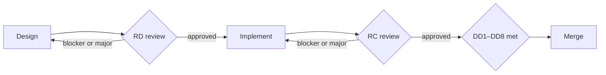

# Stockkart Review Rubric

## Purpose

- Users: reviewer agents and humans. Scope: every design and every code change in backend or frontend.
- The rubric adds cross-repo checks, severity and done. Repository rules stay in [backend AGENTS.md](https://github.com/Stockkart/inventory-api/blob/main/AGENTS.md) and [frontend AGENTS.md](https://github.com/Stockkart/inventory-platform/blob/main/AGENTS.md).
- Paths start with `backend/` (inventory-api root) or `frontend/` (inventory-platform root).
- A bare rule ID (L6, E7) is a backend AGENTS.md rule. `backend › <Section>` and `frontend › <Section>` are AGENTS.md sections.
- Answer each item yes, no or n/a.

## How to use this rubric

- Every finding cites one of: a rubric ID (`REVIEW_RUBRIC RC4`); a backend AGENTS.md rule ID (`backend AGENTS.md E7`); a frontend AGENTS.md section (`frontend AGENTS.md › Styling`); an ADR in decisions/.
- A finding with no citation is a preference. Its severity is at most minor.
- Finding format: `<severity> <ID>: <path>[:line] — <what is wrong> — cite <rule>`.
- Every "no" is a finding.
- Where the rubric and an AGENTS.md disagree, the AGENTS.md wins for its own repository.

## Design review checklist

### Architecture
- RD1. Is the owning module or package named? (A1; frontend › Repository layout)
- RD2. Do new calls follow existing pom edges or Nx tags? (L1, L2; frontend › Nx workspace structure and project boundaries)
- RD3. Does it extend a named file's pattern, or justify a new one in Risks?
- RD4. Does it keep controller → service → repository (L3, L4) and page → `queries/hooks.ts` → `api/`? (frontend › State and data fetching)
- RD5. Does an edit to a shared chrome class list every consumer file from the consumer grep? (frontend › Styling)

### Correctness
- RD6. Does every claim about code cite a path? (W3)
- RD7. Does shop scope come only from request attribute `shopId`? (L6, E7)
- RD8. Do new errors map through `ErrorCode` with a status? (E3, E5)
- RD9. Does a new field state its `null` meaning for old documents? (P5)
- RD10. Does nothing rely on `@Transactional` or `@Indexed`? (P8, P4)
- RD11. Do vertical fields come from `platform/schema`, with no hardcoded form? (frontend › State and data fetching)

### Cross-repo contract
- RD12. Does it list every shape both repos must agree on, or say None?
- RD13. Do JSON responses use `ApiResponse<T>`? (E1; `frontend/platform/contracts/src/index.ts`)
- RD14. Does it state merge order, backend first? (A10)
- RD15. Does a changed or removed field name each frontend caller in `core/<d>/src/api/`?

### Tests
- RD16. Does it name each test file and its level from the Testing tables? (backend › Testing; frontend › Testing)
- RD17. Does every acceptance criterion have a verification step?
- RD18. Does it say how tests are set up in a module that has none? (T9; frontend › Testing)

### Security
- RD19. Does it list every new public path with a reason? (X3)
- RD20. Does it give env var names only, never values? (C2, W5)
- RD21. Does it keep secrets out of `VITE_*` variables? (frontend › State and data fetching)
- RD22. Does it state the RBAC prefix and plan-expiry placement of a new endpoint? (A9)

### Writing style
- RD23. Are sentences short and plain, with tables and inline Mermaid over paragraphs? (W1, W2)
- RD24. Do notes and comments say why, with no history? (W4)

## Code review checklist

Same six groups as the design review, then three more.

### Architecture
- RC1. Do imports follow pom edges, Nx tags and package `exports`? (L1, L8; frontend › Nx workspace structure and project boundaries)
- RC2. Does no new file import another module's `domain.repository` package? (L5)
- RC3. Does no controller inject a repository or `MongoTemplate`? (L3)
- RC4. Does no `platform/*` file import `core/*` or `plugins/*`? (frontend › Nx workspace structure and project boundaries)
- RC5. Do new files follow the module layout? (R1, R2; frontend › Repository layout)

### Correctness
- RC6. Backend: Do services that touch shop data check `shopId` and throw `AuthenticationException`? (E7)
- RC7. Backend: Do user errors throw `core/common` exceptions, never `IllegalArgumentException`? (E4, X7)
- RC8. Backend: Is money `BigDecimal`? (P7)
- RC9. Backend: Do JSON endpoints return `ResponseEntity<ApiResponse<T>>`? (E1)
- RC10. Frontend: Does all HTTP go through `apiClient` and a `<name>Api` object? (frontend › State and data fetching; `frontend/platform/api-client/src/lib/client.ts`)
- RC11. Frontend: Is `useNotify` destructured, not called? (frontend › Component conventions; `frontend/core/reminders/src/ui/ReminderForm.tsx`)
- RC12. Frontend: Do Recharts sit inside `chartChrome.plot`? (frontend › Styling; `frontend/core/analytics/src/ui/SalesByGroupChart.tsx`)
- RC13. Frontend: Is a new `--sk-*` token in both the light and the dark block? (frontend › Styling; `frontend/ui-kit/src/theme/tokens.css`)
- RC14. Frontend: Do vertical fields come from `platform/schema`, with no hardcoded form? (frontend › State and data fetching)

### Cross-repo contract
- RC15. Does the diff match the approved design field by field?
- RC16. Do frontend `model/` types in the diff match the backend DTO fields in camelCase? (N3, N4)
- RC17. Does a changed backend field leave no frontend caller from the design's list unchanged?

### Tests
- RC18. Does each changed behaviour have a test at the Testing table's level? (backend › Testing; frontend › Testing)
- RC19. Does every test the diff deletes have a replacement or a waiver in the design's Risks? (DD2)
- RC20. Does a change to `*Properties` tests or Mongo queries come with the K2 command in the design's test plan? (K2)

### Security
- RC21. Backend: Is no `.env` tracked and no secret value in the diff? (C4, X12)
- RC22. Backend: Is there no `System.getenv`? (C1, X9)
- RC23. Backend: Are secrets kept out of logs? (X11)
- RC24. Backend: Is a new public path in both lists? (X3)
- RC25. Frontend: Is no secret value in a `VITE_*` variable? (frontend › State and data fetching)
- RC26. Frontend: Does app code read env through `import.meta.env`, with only `frontend/apps/inventory/vite.config.mts` on `process.env`? (frontend › State and data fetching)

### Writing style
- RC27. Do comments say why, with no history or narration? (W4)

### Scope discipline
- RC28. Does every changed file trace to a design item or acceptance criterion?
- RC29. Is legacy code left unconverted unless the task asks? (frontend › State and data fetching)

### Unrelated changes
- RC30. Is there no reformatting, renaming or refactoring outside scope?
- RC31. Are there no version bumps outside scope?
- RC32. Are there no files from another task?

### Conventions compliance
- RC33. Do names follow N1–N7 and frontend › Component conventions?
- RC34. Does no new entry join an AGENTS.md exception list? (frontend › Purpose)
- RC35. Does the diff add no descendant selector between chrome classes? (frontend › Styling)
- RC36. Does an edit to a shared chrome class change every consumer the design lists, or add a modifier key instead? (RD5; frontend › Styling)
- RC37. Do new plugins and dependencies carry versions? (S2, X10)
- RC38. Does a new metric have its constant and its `docs/metrics.md` row? (N7, X1)
- RC39. Does every new controller carry `@Latency`, `@RecordRequestRate` and `@RecordStatusCodes`? (X2)

## Severity

| Level | Definition | Merge rule |
|---|---|---|
| Blocker | The change breaks tenancy, security, data or another view; fails an acceptance criterion; contradicts an ADR in decisions/; or fails CI. | Fix before merge; it cannot be waived. |
| Major | The change works and meets its acceptance criteria, but breaks an AGENTS.md or rubric rule, or leaves tests or docs incomplete. | Fix before merge, or a human records a waiver in the PR body. |
| Minor | A readability or local-consistency slip that breaks no rule and has no behaviour effect. | Fix if cheap; the change may merge. |

- Blocker examples:
  - Backend: a query scoped by a `shopId` read from the request body instead of the `shopId` request attribute set by `backend/app/src/main/java/com/inventory/app/interceptor/AuthenticationInterceptor.java`. One shop could read or write another shop's data (L6).
  - Frontend: #222 (`1335f8c`) restyled the shared `.profileHero*` classes in `frontend/ui-kit/src/patterns/SurfaceChrome.module.css` in place and regressed the Invoice numbering and label-layout views (its own body says so). It then scoped them with `.profileShopCard .profileHero` descendant rules. #223 (`d4ce2d0`) reverted the whole PR (frontend › Styling).
- Major examples:
  - Backend: #251 (squashed into #250, `c00e7ef5`) added the missing shop-context check to both endpoints of `backend/core/product/src/main/java/com/inventory/product/rest/controller/RefundController.java`. Without it, a request with no shop context hit an NPE and got 500, not 401 (E7). The assemblers already refused other shops' documents, so no tenancy break.
  - Frontend: a new server read through `useEffect` + `<name>Api` instead of `core/<d>/src/queries/hooks.ts`, the legacy pattern of `frontend/core/pricing/src/pages/PricingPage.tsx` (frontend › State and data fetching).
- Minor examples:
  - Backend: `backend/core/product/src/main/java/com/inventory/product/service/InvoiceService.java` named `ShopInvoiceSettingsDocument` by its fully qualified name, where every other file in the package imports it. #250 (`c00e7ef5`) fixed it from review on #180.
  - Frontend: a diff adds a `../model` type import to `frontend/core/reminders/src/queries/hooks.ts`, whose type imports all use `@inventory-platform/<d>/types` (frontend › Component conventions, "Match the file you edit").

## Definition of done

- DD1. CI passes:
  - Backend: K1 `mvn -pl app -am clean test`; Commands #3/#4 under K2; Commands #8/#9 when `scripts/` or `.github/workflows/` change (`backend/.github/workflows/ci-hygiene.yml`).
  - Frontend: `nx lint`, `nx typecheck` and `NODE_ENV=development nx test` on touched projects; `nx build inventory`; `pnpm run format:check` (`frontend/.github/workflows/ci.yml`, `frontend/.github/workflows/format.yml`).
  - Frontend, new package: `node .github/scripts/check-package-tracking.mjs` (frontend › New package checklist).
- DD2. New behaviour has tests at the Testing table's level. A deleted test needs a replacement or a waiver in the design's Risks and the PR body. Example: #250 (`c00e7ef5`) dropped `InvoiceServiceTest`, the only coverage of the cross-shop rejection in `InvoiceService`, and said so in its body.
- DD3. Docs: README endpoint tables (X4), the `docs/metrics.md` row (X1), the package README when ownership or public API changes (`frontend/.github/PULL_REQUEST_TEMPLATE.md`, Checklist), and the handbook doc when a cross-repo fact changes.
- DD4. Migrations: indexes via an `ensureIndex` runner (P4); backfills per P6 (idempotent, `enabled` flag, passthrough property).
  - Removing a runner lists the removed properties and env vars, as the #266 (`ddfd9d79`) body does.
- DD5. Env vars: backend in the three places of C2; frontend in `.env-example` and the `nx.targets.build` env inputs of `frontend/apps/inventory/package.json`; an AGENTS.md row with name and purpose, never a value (W5).
- DD6. AGENTS.md changes in the same PR when a convention, a `Ref:` file, a count or an exception list changes. Example: #266 deleted `SellRestrictionBackfillRunner.java`, still the `Ref:` of backend AGENTS.md P6.
- DD7. PR body:
  - Conventional Commits title (`frontend/.github/workflows/pr-title.yml`); `## Summary` and `## Test plan` with commands and results (`frontend/.github/workflows/pr-description.yml`); `## Risk & rollback`.
  - `## Screenshots / recordings` for UI; a shared-class edit lists every consumer file with a screenshot of each view (frontend › Styling).
  - Flags for public paths (X3), env vars added or removed, collections left behind, deferred work, waivers, and for a frontend PR on a new endpoint the merged backend PR (A10).
- DD8. No blocker or unwaived major is open.

## Writing style for documents and comments

- W1. Short sentences in plain English, one idea per sentence.
- W2. Tables and bullets over paragraphs. Diagrams in inline Mermaid.
- W3. A path for every fact about code. Link AGENTS.md; do not copy it.
- W4. Code comments say why. History and review rounds go in the commit message.
- W5. Env var and secret names only, never values.
- Cut: restated task, narration, hedges, filler intros and closing summaries, duplicated rules; write `None` for an empty section.
