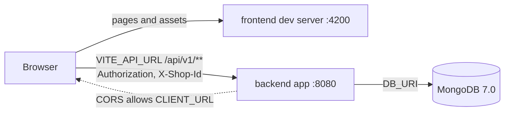

# Runbook

Verified 2026-10-18 in the task workspace; backend `ddfd9d79`, frontend `780e504`.

## Purpose

- How to run, test and debug Stockkart on a local machine and in the pipeline task workspace.
- Readers: coding agents and humans.
- Each command carries a result: `PASS`, `NEEDS-ENV: <names>`, `FAIL: <error>`, or `recipe, not run (<reason>)`. `(run: …)` marks a command executed in the task workspace; its logs were in `.sdlc/runbook-verify/`.
- Repository rules live in [backend AGENTS.md](https://github.com/Stockkart/inventory-api/blob/main/AGENTS.md) and [frontend AGENTS.md](https://github.com/Stockkart/inventory-platform/blob/main/AGENTS.md). This file does not repeat them.

## Prerequisites

| Tool | Version | Source | Task workspace (observed) |
|---|---|---|---|
| JDK | Temurin 21 | `backend/pom.xml`, `backend/.github/workflows/build-checker.yml` | `.sdlc/tools/jdk-21.0.12.1+1`, not on `PATH` |
| Maven | 3.9+; no `mvnw` | `backend/app/.mvn/wrapper/maven-wrapper.properties` | `.sdlc/tools/apache-maven-3.9.9`, not on `PATH` |
| MongoDB | 7.0 | `backend/docker-compose.yml` (commented `mongo:7.0`) | 7.0.14 in `.sdlc/tools/`, running on `127.0.0.1:27017` |
| Node | 20 | `frontend/.github/workflows/ci.yml` | 20.20.2 on `PATH` |
| pnpm | 9.8.0 | `frontend/.github/workflows/ci.yml` | not installed; `npx --yes pnpm@9.8.0` works |
| Docker + Compose | Compose that supports the `!override` and `!reset` merge tags | both `docker-compose.yml`; the override files below | client 29.9.1, Compose v5.6.0; remote daemon shared with other tasks |
| actionlint | 1.7.7 | `backend/.github/workflows/ci-hygiene.yml` (`rhysd/actionlint:1.7.7`) | not installed |
| shellcheck | unpinned in CI (`ubuntu-latest`); 0.10.0 in backend AGENTS.md "Commands" | `backend/.github/workflows/ci-hygiene.yml` | not installed |

Task workspace setup, from the workspace root:
- `export JAVA_HOME=$PWD/.sdlc/tools/jdk-21.0.12.1+1 PATH=$PWD/.sdlc/tools/jdk-21.0.12.1+1/bin:$PWD/.sdlc/tools/apache-maven-3.9.9/bin:$PATH` (run: PASS; `java -version` 21.0.12.1, `mvn -v` 3.9.9).
- Start MongoDB only if it is not running: `.sdlc/tools/mongodb-linux-x86_64-debian12-7.0.14/bin/mongod --dbpath .sdlc/tools/mdata --port 27017 --bind_ip 127.0.0.1 --fork --logpath .sdlc/logs/mongod.log` (recipe, not run: already running; `ps` shows this command line).
- Check it: `curl -s http://127.0.0.1:27017/` (run: PASS; "It looks like you are trying to access MongoDB over HTTP on the native driver port.").
- Load project variables: `set -a; . .sdlc/env/backend.env; set +a` (run: PASS). Both `.sdlc/env/backend.env` and `.sdlc/env/frontend.env` are empty in this task, so no project variable is set.
- The shell presets `NODE_ENV=production` and `CI=1`. Override `NODE_ENV` per command (frontend AGENTS.md "Commands").
- Missing here: `ss`, `lsof`, `fuser`, `netstat`, `jq`, `mongosh`, `python3`, `xz`, `wget`. Find listeners with `ps` and `curl`.

## Backend: run, test, lint

Run from `backend/`.

| Command | Needs | Duration | Result |
|---|---|---|---|
| `mvn -pl app -am clean test` (CI, `.github/workflows/build-checker.yml`) | JDK 21, Maven, `~/.m2` or network; no env vars | 51 s | PASS: 465 tests, 0 failures, 0 errors |
| `mvn -pl core/product -am test -Dtest='*Properties' -Dsurefire.failIfNoSpecifiedTests=false` | same | 8 s | PASS: 49 tests |
| `mvn -pl core/product -am test -Dtest='InventorySearch*IT' -Dsurefire.failIfNoSpecifiedTests=false -Dstockkart.test.mongo.uri=<throwaway db uri>` | reachable MongoDB; a system property, not an env var | 12 s | PASS: 16 tests |
| `mvn clean install -DskipTests` | JDK, Maven | 35 s | PASS: builds `app/target/app-1.0.0.jar` |
| `mvn -pl app spring-boot:run` (after install), no variables set | boot variables | 5 s to exit | NEEDS-ENV: all `yes` and `defined` names. First error: `Could not resolve placeholder 'OCR_PREPROCESS_MODE' in value "${OCR_PREPROCESS_MODE}"` |
| `mvn -pl app spring-boot:run` with the boot set in the shell and `SERVER_PORT` | boot set | 10 s to UP | PASS: `GET /actuator/health` → `{"status":"UP"}` |
| `java -jar app/target/app-1.0.0.jar` with the boot set | boot set | 9 s to UP | PASS: same; without the set it fails as in the probes (Environment variables) |
| `shellcheck -x -P SCRIPTDIR -s bash scripts/deploy/*.sh` (CI hygiene) | shellcheck | about 1 s in Docker | FAIL here: `shellcheck: command not found`. Same arguments in image `koalaman/shellcheck:v0.10.0`, scripts copied in with `docker cp`: PASS, no findings |
| `actionlint` (CI hygiene) | actionlint | under 1 s | FAIL here: `actionlint: command not found`. Release binary 1.7.7: PASS, no findings |

- Boot set used here: `DB_URI` (local throwaway database), `CLIENT_URL`, `OCR_PROVIDER` (`aws-textract`), `AWS_REGION`, `UPLOAD_TOKEN_EXPIRY_MINUTES`, `OCR_PREPROCESS_MODE` (`none`), and the other `defined` names set empty.
- There is no Java linter or formatter. Why `*Properties` and `*IT` need their own commands: backend AGENTS.md "Testing" T5, T6.
- `.env`: `AppApplication` loads `./.env` from the working directory. `spring-boot:run` reads `app/.env`; `java -jar` from `backend/` reads `backend/.env` (backend AGENTS.md "README drift"). Shell variables work for both.
- `SERVER_PORT` moves the app off 8080 (Spring Boot relaxed binding; this run used 8897–8899).
- `spring-boot-maven-plugin` has no version, so `spring-boot:run` resolved `4.2.0-M2` (backend AGENTS.md S2).
- `/actuator/health`, `/actuator/info` and `/actuator/prometheus` return 200 without a token. `/api/v1/customers` without a token returns 401 (run).

## Frontend: run, test, lint, typecheck

Run from `frontend/`. In the task workspace `pnpm` is `npx --yes pnpm@9.8.0`. Rows are in run order. Durations used `--skip-nx-cache`; cached runs are faster.

| Command | Needs | Duration | Result |
|---|---|---|---|
| `NODE_ENV=development pnpm install --frozen-lockfile` | Node 20, pnpm 9.8.0 | 6 s | PASS |
| `pnpm run format:check` | no `out-tsc/` in the tree | 16 s | FAIL here: `Code style issues found in 29 files. Forgot to run Prettier?` All 29 are in gitignored `out-tsc/` left by typecheck; `out-tsc` is not in `.prettierignore` |
| `git ls-files -z \| xargs -0 pnpm exec prettier --check --ignore-unknown` | — | 18 s | PASS: `All matched files use Prettier code style!` |
| `pnpm exec nx run-many -t lint --all` | — | 38 s | PASS: 24 projects, 0 errors, 44 warnings |
| `pnpm exec nx run-many -t typecheck --all` | — | 63 s | PASS: 24 projects |
| `NODE_ENV=development pnpm exec nx run-many -t test --all` | `NODE_ENV` not `production` | 17 s | PASS: 3 projects, 253 tests |
| `pnpm exec nx run-many -t test --all` with the preset `NODE_ENV=production` | — | 17 s | FAIL: `TypeError: React.act is not a function`; user 20/32 and product 27/218 fail |
| `pnpm exec nx build inventory` | `VITE_*` optional; build inputs in `apps/inventory/package.json` | 52 s | PASS with no `VITE_*` set |
| `node .github/scripts/check-package-tracking.mjs` | — | under 1 s | PASS |
| `NODE_ENV=development pnpm exec nx dev inventory` | port 4200 free; `VITE_API_URL` optional | 23 s to first 200 | PASS: `GET http://localhost:4200/` 200; log prints `API Base URL: http://localhost:8080/api/v1` |
| `pnpm exec react-router dev --port <n>`, from `apps/inventory/` | port `<n>` free | 22 s to first 200 | PASS on 4207: `GET /` 200 |

- Vite reads `.env` from `apps/inventory/`, not the repo root. `root` is `apps/inventory` (`apps/inventory/vite.config.mts`), and `@react-router/dev` uses it as `envDir`. `frontend/.env` affects compose only.
- Installing with `NODE_ENV=production` skips devDependencies and fails (Common failures).

## Running both together



| Repo | Compose file | Service / `container_name` / image | Port | Health |
|---|---|---|---|---|
| backend | `backend/docker-compose.yml` | `app` / `inventory-backend` / `inventory-backend:local` | `8080:8080`, fixed | `GET /actuator/health` → `{"status":"UP"}`, no token |
| frontend | `frontend/docker-compose.yml` | `inventory-platform` / `inventory-platform` / none (Compose names it `<project>-inventory-platform`) | `${INVENTORY_PLATFORM_PORT:-4200}:4200` | none; `GET /` returns 200 |

- The backend image builds with Maven and runs `java -jar app.jar` (`backend/Dockerfile`). Only that image serves `/commit.txt`.
- The frontend container runs the dev server: `pnpm nx dev inventory --host 0.0.0.0` (`frontend/Dockerfile.dev`).

Compose in the task workspace. `<be>` = `-p sdlc-aaty5t3h-be -f docker-compose.yml -f ../.sdlc/runbook-verify/be-override.yml`. `<fe>` = the same with `-fe` and `fe-override.yml`, plus `INVENTORY_PLATFORM_PORT=14200`. Locally, drop `-p` and `-f`.

```yaml
# be-override.yml
services:
  app:
    image: inventory-backend-aaty5t3h:local
    container_name: inventory-backend-aaty5t3h
    ports: !override
      - "18080:8080"
# fe-override.yml
services:
  inventory-platform:
    image: inventory-platform-aaty5t3h:local
    container_name: inventory-platform-aaty5t3h
    env_file: !reset []
    volumes: !reset []
```

| Command (from `<repo>/`) | Needs | Duration | Result |
|---|---|---|---|
| backend `docker compose <be> config --quiet` | — | under 1 s | PASS; warns `The "DB_URI" variable is not set. Defaulting to a blank string.` for each unset name |
| backend `docker compose <be> build` | Docker daemon | 89 s | PASS |
| backend `docker compose <be> up -d`, then `ps`, `logs` | boot variables in `backend/.env` | 1 s to start | NEEDS-ENV: DB_URI and the boot set. The container restarts in a loop; logs show `connection string is invalid` |
| backend `docker compose <be> down` | — | 1 s | PASS |
| frontend `docker compose <fe> config --quiet` | `.env`, or `env_file: !reset []` | under 1 s | PASS |
| frontend `docker compose <fe> build` | Docker daemon | 3 s, layer cache | PASS |
| frontend `docker compose <fe> up -d`, then `ps`, `logs` | none; `VITE_API_URL` has a compose default | about 32 s to 200 | PASS: `Up`; logs show `Local:   http://localhost:4200/`; `docker exec inventory-platform-aaty5t3h wget -q -O /dev/null -S http://localhost:4200/` → `HTTP/1.1 200`. Host port 14200 does not answer from the workspace (`curl` 000) |
| frontend `docker compose <fe> down` | — | 1 s | PASS |

- No compose file starts both repos. Each compose project has its own default network. The browser calls the API directly, so this does not matter.
- `mongodb`, `image-preprocess` (backend) and `inventory-server` (frontend) are commented out. Run MongoDB yourself.
- `frontend/README.md` says "Docker (frontend + API + Mongo)". The compose file starts only the frontend.
- The frontend compose bind-mounts `.:/app`. On the remote daemon here a workspace bind mount is empty (run). The override resets `volumes`, so the image's `COPY . .` is used.

How the frontend finds the backend:
- `VITE_API_URL`, read through `import.meta.env` in `platform/api-client/src/lib/client.ts` at dev or build time. Default `http://localhost:8080/api/v1`. It must be reachable from the browser.
- `CLIENT_URL` must equal the frontend origin; `CorsConfig` reads `client.url`. Preflight from `http://localhost:4200` returned 200 with `Access-Control-Allow-Origin` and `authorization, x-shop-id` allowed; another origin got 403 (run).
- The mobile upload base is `VITE_MOBILE_API_URL`, else derived from `VITE_API_URL` (`core/product/src/api/upload.api.ts`).

Local recipe (run: PASS; backend UP and frontend 200 after 23 s, preflight 200):
1. Start MongoDB 7.0.
2. In `backend/`: set the boot set with `CLIENT_URL` = `http://localhost:4200`; run `java -jar app/target/app-1.0.0.jar` or `mvn -pl app spring-boot:run`.
3. In `frontend/`: `NODE_ENV=development pnpm exec nx dev inventory`. The default `VITE_API_URL` points at port 8080.

Task workspace:
- The Docker daemon is shared with other tasks. Published ports bind on the daemon host, not in the workspace.
- A container's `127.0.0.1` is the container itself, and the daemon is on another host. Containers cannot use the workspace mongod.
- Use `-p sdlc-<task>-be` / `-p sdlc-<task>-fe` and override files under `.sdlc/`. Run `down` and remove the task's images when done.

## Environment variables

- Names are exactly those in `backend/docker-compose.yml` and `backend/.env.example` (34), and in `frontend/docker-compose.yml` and `frontend/.env-example` (8).
- Required: `yes` = must be non-empty. `defined` = must exist, may be empty; unset fails boot with `Could not resolve placeholder '<NAME>'`. `no` = has a default or is not read.
- Each backend name was probed with `java -jar`, one name unset or empty at a time (logs `probe-*`). Names not in the boot set booted fine when unset.
- Example: only defaults or allowed values from code, compose or `application.properties`, or a localhost URL. `secret` = never commit, never log. ✓ = declared, `—` = absent.

Backend (properties in `backend/app/src/main/resources/application.properties`):

| Name | Purpose | Required | Example | compose | `.env.example` |
|---|---|---|---|---|---|
| `DB_URI` | MongoDB connection URI | yes; empty → `connection string is invalid` | secret | ✓ | ✓ |
| `DB_USERNAME` | root user of the commented-out `mongodb` service | no; not read by the app | secret | — (commented) | ✓ |
| `DB_PASSWORD` | root password of the same service | no; not read by the app | secret | — (commented) | ✓ |
| `CLIENT_URL` | frontend origin for CORS; links in emails | defined; empty boots (run), but then the frontend origin fails CORS (`CorsConfig`) | `http://localhost:4200` | ✓ | ✓ |
| `OCR_PROVIDER` | OCR provider for invoice images | yes; empty → `No qualifying bean of type 'com.inventory.ocr.provider.OcrProvider' available` | `aws-textract`, `chatgpt`, `gemini` | ✓ | ✓ |
| `OCR_OPENAI_MODEL` | model for `chatgpt` | defined | `gpt-4.1` | ✓ | ✓ |
| `OCR_GEMINI_MODEL` | model for `gemini` | defined | `gemini-2.5-flash` | ✓ | ✓ |
| `OCR_PREPROCESS_MODE` | image preprocessing mode | defined | `none`, `subprocess`, `http` | ✓ (default `http`) | ✓ |
| `OCR_PREPROCESS_URL` | preprocessing service URL | defined; non-empty for `http` (`ocr.preprocess.url is required when ocr.preprocess.mode=http`) | compose default | ✓ | ✓ |
| `OCR_PREPROCESS_PYTHON_PATH` | Python interpreter for `subprocess` | defined | `python3` | ✓ | ✓ |
| `OCR_PREPROCESS_WORKING_DIR` | working directory for `subprocess` | defined | — | ✓ | ✓ |
| `OPENAI_API_KEY` | OpenAI key | defined; yes for `chatgpt` (`openai.api-key is required when ocr.provider=chatgpt.`) | secret | ✓ | ✓ |
| `GEMINI_API_KEY` | Gemini key | defined; yes for `gemini` (`gemini.api-key is required when ocr.provider=gemini.`) | secret | ✓ | ✓ |
| `AWS_ACCESS_KEY` | Textract access key id | defined | secret | ✓ | ✓ |
| `AWS_SECRET_ACCESS` | Textract secret key | defined | secret | ✓ | ✓ |
| `AWS_REGION` | Textract region | defined; yes for `aws-textract` (empty → `region must not be blank`) | — | ✓ | ✓ |
| `UPLOAD_TOKEN_EXPIRY_MINUTES` | mobile upload token lifetime, integer minutes | yes; empty → `NumberFormatException: For input string: ""` | — | ✓ | ✓ |
| `MESSAGING_EMAIL_ENABLED` | turn email sending on | no; default `false` | `false` | ✓ | ✓ |
| `RESEND_API_KEY` | Resend API key | no; defined when email is on (unset → `Could not resolve placeholder 'RESEND_API_KEY'`) | secret | ✓ | ✓ |
| `RESEND_FROM_EMAIL` | sender address | no; defined when email is on | compose default | ✓ | ✓ |
| `RESEND_FROM_NAME` | sender name | no; defined when email is on | compose default | ✓ | ✓ |
| `GRAFANA_CLOUD_OTLP_URL` | OTLP metrics endpoint | no; default empty | — | ✓ | ✓ |
| `GRAFANA_CLOUD_OTLP_USER` | OTLP user | no; default empty | — | ✓ | ✓ |
| `GRAFANA_CLOUD_LOKI_URL` | Loki log push endpoint | no; default empty | — | ✓ | ✓ |
| `GRAFANA_CLOUD_LOKI_USER` | Loki user | no; default empty | — | ✓ | ✓ |
| `GRAFANA_CLOUD_API_TOKEN` | Grafana Cloud token | no; default empty | secret | ✓ | ✓ |
| `SPRING_PROFILES_ACTIVE` | Spring profile | no; default `local` | `local`, `prod` | ✓ | ✓ |
| `PAYMENT_GATEWAY` | payment gateway for plans | no; default `razorpay` | `razorpay` | ✓ | ✓ |
| `RAZORPAY_KEY_ID` | Razorpay key id | no; default empty | — | ✓ | ✓ |
| `RAZORPAY_KEY_SECRET` | Razorpay API secret | no; default empty | secret | ✓ | ✓ |
| `RAZORPAY_WEBHOOK_SECRET` | Razorpay webhook secret | no; default empty | secret | ✓ | ✓ |
| `GSTIN_PROVIDER` | online GSTIN lookup provider | no; default `none` (offline check) | `none`, `gstinapi` | — | ✓ |
| `GSTINAPI_KEY` | GSTIN lookup API key | no; default empty | secret | — | ✓ |
| `MESSAGING_DISPATCH_INTERVAL_MS` | outbound message dispatch interval | no; default `15000` | `15000` | ✓ | — |

Overrides with a built-in default, in neither file: backend AGENTS.md "Configuration and environment variables".

Backend discrepancies (listed, not fixed):
- Only in `.env.example`: `DB_USERNAME`, `DB_PASSWORD`, `GSTIN_PROVIDER`, `GSTINAPI_KEY`. Under compose the last two never reach the container.
- Only in compose: `MESSAGING_DISPATCH_INTERVAL_MS`.
- `OCR_PREPROCESS_MODE`: compose defaults to `http` with a URL on the commented-out `image-preprocess:8081`. `OcrConfig` defaults to `none`. `application.properties` has no default. Compose `:-` also turns an empty value into `http`.
- `.env.example` leaves `OCR_PROVIDER` and `UPLOAD_TOKEN_EXPIRY_MINUTES` empty, so `cp .env.example .env` alone does not boot.
- `RESEND_FROM_EMAIL` and `RESEND_FROM_NAME` have compose defaults but none in `application.properties`.
- Compose has no `env_file`. It only interpolates from `backend/.env`; a missing file gives warnings, not an error.

Frontend:

| Name | Purpose | Required | Example | compose | `.env-example` |
|---|---|---|---|---|---|
| `VITE_API_URL` | API base URL the browser calls | no; default in `client.ts` and compose | `http://localhost:8080/api/v1` | ✓ (default) | ✓ |
| `VITE_GOOGLE_CLIENT_ID` | Google OAuth client id | no; empty → Google sign-in gets an empty client id (`apps/inventory/app/root.tsx`) | — (public) | via `env_file` | ✓ |
| `VITE_FACEBOOK_APP_ID` | reserved; not read by source | no | — (public) | via `env_file` | ✓ |
| `VITE_RAZORPAY_KEY_ID` | optional; backend returns the key | no; not read by source | — (public) | via `env_file` | ✓ |
| `INVENTORY_PLATFORM_PORT` | host port of the compose service | no; default `4200` | `4200` | ✓ | ✓ |
| `NODE_ENV` | Node environment | no; compose forces `development` | `development` | ✓ (fixed) | ✓ |
| `DB_URI` | backend DB for the commented-out `inventory-server` | no; unused | secret | — (commented) | ✓ |
| `CLIENT_URL` | CORS origin for the commented-out `inventory-server` | no; unused | `http://localhost:4200` | — (commented) | ✓ |

- `VITE_*` values are public in the bundle, so none is `secret`. The `.env` file itself is required by compose (`env_file: .env`).
- `VITE_MOBILE_API_URL`, `VITE_BUILD_SHA`, `VITE_ALLOWED_HOSTS`: frontend AGENTS.md "State and data fetching".

Frontend discrepancies (listed, not fixed):
- `DB_URI` and `CLIENT_URL` serve only the commented-out `inventory-server`.
- Compose sets `NODE_ENV=development` under `environment:`, which beats `env_file:`. The `.env-example` entry has no effect.
- `VITE_API_URL` has a compose default; `.env-example` leaves it empty.
- `VITE_GOOGLE_CLIENT_ID`, `VITE_FACEBOOK_APP_ID` and `VITE_RAZORPAY_KEY_ID` reach the container only through `env_file: .env`.

## Common failures and fixes

Fix commands are recipes. `(run: …)` marks the ones executed in the task workspace.

| Symptom (exact message) | Cause | Fix |
|---|---|---|
| `Error response from daemon: Conflict. The container name "/inventory-backend-aaty5t3h" is already in use by container "<id>". You have to remove (or rename) that container to be able to reuse that name.` (run: second `up --no-start` under `-p sdlc-aaty5t3h-be2`) | Both compose files fix `container_name`; `-p` does not change it. Without an override the names are `/inventory-backend` and `/inventory-platform`. The backend `image: inventory-backend:local` is a fixed tag too; each build on a shared daemon overwrites it. | Find the owner: `docker ps -a --filter name=inventory-` (run: PASS). Never remove another task's container. Use an override with your own `image`, `container_name` and port (Running both together). |
| `env file …/frontend/.env not found: stat …/frontend/.env: no such file or directory` (run: frontend `config` without the `env_file` reset) | Frontend compose requires `.env` (`env_file: .env`). | Locally: `cp .env-example .env` (recipe, not run: the repo must stay clean). Pipeline: `env_file: !reset []` in the override (run: PASS). |
| `The "DB_URI" variable is not set. Defaulting to a blank string.`, then container logs `connection string is invalid` (run) | Backend compose has no `env_file`; without `backend/.env` every name is blank. | Create `backend/.env` from `.env.example` and fill the boot set (recipe, not run), or pass `--env-file <file outside the repo>` (recipe, not run). |
| `Web server failed to start. Port 8080 was already in use.` (run: second boot on 8080) | Another process holds 8080. | Stop it, or set `SERVER_PORT` (run: PASS on 8897–8899). |
| `Waiting for @inventory-platform/inventory:dev in another nx process` (run) | An `nx dev` already runs in this workspace. | Stop its process group: `kill -- -<pgid>`. Killing only `nx.js` leaves `@react-router/dev/bin.js dev` serving 4200 (run: 200 after killing `nx.js`, 000 after the group). Or run `react-router dev --port <n>` from `apps/inventory/` (run: PASS). |
| `Port 4200 is in use, trying another one...`, then `Local:   http://localhost:4201/` (run: dummy listener on 4200; 4201 → 200) | `vite.config.mts` sets `server.port: 4200` without `strictPort`. | Free 4200, or use the printed port and set `CLIENT_URL` to that origin. |
| `Bind for 0.0.0.0:14201 failed: port is already allocated` (run: a container held 14201) | The compose host port is taken on the daemon host. | Frontend: set `INVENTORY_PLATFORM_PORT` (run: 14200 PASS). Backend: `ports: !override` in the override (run: 18080 PASS). |

Other failures, each reproduced in this run:
- `Could not resolve placeholder '<NAME>'`: a `defined` name is unset (logs `probe-unset-*`). Set it, empty if allowed.
- `NumberFormatException: For input string: ""`: `UPLOAD_TOKEN_EXPIRY_MINUTES` is empty. Give an integer.
- `No qualifying bean of type 'com.inventory.ocr.provider.OcrProvider' available`: `OCR_PROVIDER` is empty.
- `region must not be blank`: `AWS_REGION` is empty while `OCR_PROVIDER` is `aws-textract`.
- `Timed out while waiting for a server that matches ReadPreferenceServerSelector{readPreference=primary}`: no MongoDB at `DB_URI`; the app exits after about 40 s (backend AGENTS.md "Commands" #7).
- `TypeError: React.act is not a function`: tests ran with `NODE_ENV=production`. Prefix `NODE_ENV=development`.
- `Packages: -1034`, then `. prepare: sh: 1: husky: not found` and `ELIFECYCLE  Command failed.`: install ran with `NODE_ENV=production` and removed devDependencies. Fix: `NODE_ENV=development pnpm install --frozen-lockfile` (run: PASS, 4 s).
- `Code style issues found in 29 files. Forgot to run Prettier?` from `format:check`: files in `out-tsc/`. Use the tracked-files prettier command (run: PASS), or delete `out-tsc/` on a local machine (recipe, not run).
- `shellcheck: command not found` / `actionlint: command not found`: install the CI versions (Prerequisites). The CI form `docker run -v "${PWD}:/repo" …` sees an empty `/repo` on a remote daemon (run: bind mount of `backend/` lists 0 entries). Copy files in with `docker cp` instead (run: PASS for shellcheck).
