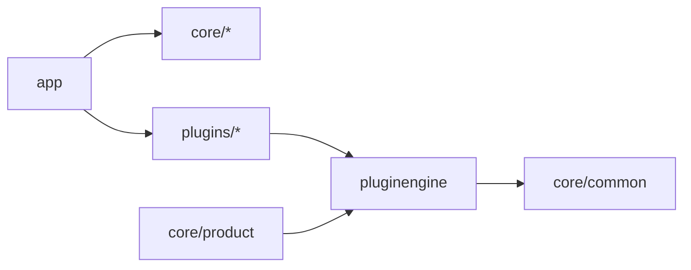

# 0002. Spring Boot modular monolith with plugins per vertical

## Status

Accepted (recorded retrospectively).
Recorded against inventory-api `ddfd9d79` and inventory-platform `780e504`.

## Context

- One backend serves shops of four business verticals: medical, grocery, sports, cafe.
- Reason not recorded.

## Decision

- One Maven reactor with four modules: `app`, `core`, `plugins`, `pluginengine`.
- Spring Boot 3.3.0 is imported as a BOM.
- 15 business modules live under `core/`.
- One deployable: `app` depends on every module and plugin, and scans `com.inventory.*`.
- Each vertical is a module in `plugins/` with a `@Component` that extends `ConfiguredVerticalPlugin`.
- `VerticalPlugin` exposes optional capabilities as `Optional` getters: validators, extension repository, search, cart, checkout, quotation, UI, pricing, cards.
- `PluginRegistry` collects all `VerticalPlugin` beans by `verticalId`. It skips blank ids and fails on duplicates.
- A shop selects its vertical by `Shop.verticalId` and `Shop.pluginVersion`.

## Consequences

- All modules run in one process against one database.
- Module edges are pom dependencies. Maven rejects cycles.
- Core reaches plugin code only through `PluginRegistry`. `require` throws `ValidationException` for an unknown vertical.
- Adding a vertical touches a new plugin module, `plugins/pom.xml`, `app/pom.xml`, `@EnableMongoRepositories` in `AppApplication`, a seed JSON and `vertical.plugins.<id>.*` properties.

## Evidence (paths)

- inventory-api: `pom.xml`
- inventory-api: `core/pom.xml`
- inventory-api: `plugins/pom.xml`
- inventory-api: `app/pom.xml`
- inventory-api: `app/src/main/java/com/inventory/app/AppApplication.java`
- inventory-api: `pluginengine/src/main/java/com/inventory/pluginengine/VerticalPlugin.java`
- inventory-api: `pluginengine/src/main/java/com/inventory/pluginengine/PluginRegistry.java`
- inventory-api: `pluginengine/src/main/java/com/inventory/pluginengine/ConfiguredVerticalPlugin.java`
- inventory-api: `plugins/sports/src/main/java/com/inventory/plugins/sports/SportsPlugin.java`
- inventory-api: `core/product/src/main/java/com/inventory/product/domain/model/Shop.java`
- inventory-api: `core/product/src/main/resources/seeds/sports-v1.json`
- Rules: [backend AGENTS.md](https://github.com/Stockkart/inventory-api/blob/main/AGENTS.md) L1, L2, L8, R2, R3, P3.
