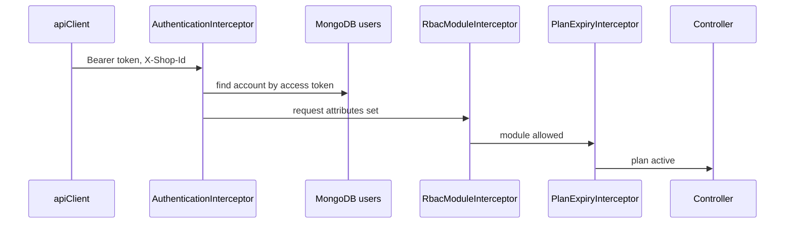

# 0007. In-app opaque bearer tokens checked by an interceptor

## Status

Accepted (recorded retrospectively).
Recorded against inventory-api `ddfd9d79` and inventory-platform `780e504`.

## Context

- Users sign in from the browser and act within one shop at a time.
- Reason not recorded.

## Decision

- Login is email and password (BCrypt encoder from `SecurityConfig`) or a Google ID token (`GoogleTokenVerifier`).
- Login and signup issue random UUID access and refresh tokens.
- Tokens are stored in `UserAccount.tokens` (`users` collection) with a device id and a 7-day expiry (`UserMapper`).
- No JWT library. Spring Security supplies only the password encoder (`spring-security-crypto`).
- `AuthenticationInterceptor` requires `Authorization: Bearer` and validates the token against MongoDB (`TokenValidationService`).
- It sets request attributes `userId`, `userRole`, `shopId`, `userAccount`, `accessToken`.
- `shopId` is the `X-Shop-Id` header when the user is a member, else the active shop.
- Public paths are listed in the interceptor and in `excludePathPatterns` in `CorsConfig`.
- Frontend `apiClient` keeps the token in `localStorage`, sends `Authorization` and `X-Shop-Id`, and calls handlers on 401 and 402.

## Consequences

- Every authenticated request reads MongoDB.
- Logout removes the token from the account (`AuthService.logout`, `UserAccount.removeToken`).
- Refresh tokens are stored, but no endpoint reads them. An expired session means a new login.
- `AuthValidator` accepts `loginType` `facebook`. `AuthService` handles only `google` and rejects the rest with `ValidationException`.

## Evidence (paths)

- inventory-api: `app/src/main/java/com/inventory/app/interceptor/AuthenticationInterceptor.java`
- inventory-api: `app/src/main/java/com/inventory/app/config/CorsConfig.java`
- inventory-api: `app/src/main/java/com/inventory/app/config/SecurityConfig.java`
- inventory-api: `core/user/src/main/java/com/inventory/user/service/TokenValidationService.java`
- inventory-api: `core/user/src/main/java/com/inventory/user/service/AuthService.java`
- inventory-api: `core/user/src/main/java/com/inventory/user/validation/AuthValidator.java`
- inventory-api: `core/user/src/main/java/com/inventory/user/externalservice/GoogleTokenVerifier.java`
- inventory-api: `core/user/src/main/java/com/inventory/user/mapper/UserMapper.java`
- inventory-api: `core/user/src/main/java/com/inventory/user/domain/model/UserAccount.java`
- inventory-api: `core/user/src/main/java/com/inventory/user/domain/model/UserToken.java`
- inventory-api: `core/user/src/main/java/com/inventory/user/rest/controller/AuthController.java`
- inventory-platform: `platform/api-client/src/lib/client.ts`
- inventory-platform: `platform/session/src/lib/useAuthStore.ts`
- Rules: [backend AGENTS.md](https://github.com/Stockkart/inventory-api/blob/main/AGENTS.md) L6, L7, E7, X3; [frontend AGENTS.md](https://github.com/Stockkart/inventory-platform/blob/main/AGENTS.md) "State and data fetching".
