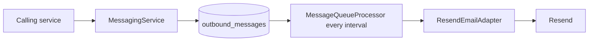

# 0008. Outbound messages: MongoDB outbox polled on a fixed delay

## Status

Accepted (recorded retrospectively).
Recorded against inventory-api `ddfd9d79` and inventory-platform `780e504`.

## Context

- `AuthService` sends emails (welcome, login alert, password reset) without waiting for the email provider.
- Reason not recorded.

## Decision

- `MessagingService` (`@Async`) writes an `OutboundMessage` with status `PENDING` to `outbound_messages`.
- `MessageQueueProcessor.processQueue` runs on `@Scheduled(fixedDelayString = "${messaging.dispatch-interval-ms:…}")`.
- `@EnableScheduling` is on `AppApplication`.
- The interval comes from env var `MESSAGING_DISPATCH_INTERVAL_MS`. It is declared in `application.properties` and compose, not in `.env.example`.
- Each run reads up to 50 due messages: `PENDING`, `retryCount` below 5, `nextRetryAt` null or past.
- A `ChannelAdapter` per channel sends. Success sets `SENT`. Failure sets exponential backoff: 10 s base, doubling, 1 h cap. The fifth failure sets `EXHAUSTED`.
- The only adapter is `ResendEmailAdapter`, active when `messaging.email.enabled` is `true`. Channel `WHATSAPP` has no adapter.

## Consequences

- Delivery waits up to one interval.
- With no adapter, messages stay `PENDING` and each run logs a warning.
- `processQueue` has no claim or lock step. Nothing stops two instances from sending the same message.
- Enqueue failures are logged and swallowed.
- Status `FAILED` exists in `MessageStatus`. No code sets it.
- The fallback in `parseDispatchIntervalMs` feeds only the startup log. `@Scheduled` reads the raw property.
- Other schedules use `@Scheduled` too: `EventService.processEventsScheduler` (`reminders.dispatch-interval-ms`, code default only) and `QRUploadService` (hourly `fixedRate`).

## Evidence (paths)

- inventory-api: `core/notifications/src/main/java/com/inventory/notifications/service/MessagingService.java`
- inventory-api: `core/notifications/src/main/java/com/inventory/notifications/service/MessageQueueProcessor.java`
- inventory-api: `core/notifications/src/main/java/com/inventory/notifications/domain/model/OutboundMessage.java`
- inventory-api: `core/notifications/src/main/java/com/inventory/notifications/domain/model/MessageStatus.java`
- inventory-api: `core/notifications/src/main/java/com/inventory/notifications/domain/repository/OutboundMessageRepository.java`
- inventory-api: `core/notifications/src/main/java/com/inventory/notifications/adapter/ChannelAdapter.java`
- inventory-api: `core/notifications/src/main/java/com/inventory/notifications/adapter/ResendEmailAdapter.java`
- inventory-api: `core/notifications/src/main/java/com/inventory/notifications/constants/MessagingConstants.java`
- inventory-api: `core/notifications/src/main/java/com/inventory/notifications/utils/MessagingUtils.java`
- inventory-api: `app/src/main/java/com/inventory/app/AppApplication.java`
- inventory-api: `app/src/main/resources/application.properties`
- inventory-api: `docker-compose.yml`
- inventory-api: `core/user/src/main/java/com/inventory/user/service/AuthService.java`
- inventory-api: `core/reminders/src/main/java/com/inventory/reminders/service/EventService.java`
- inventory-api: `core/product/src/main/java/com/inventory/product/service/QRUploadService.java`
- Rules: [backend AGENTS.md](https://github.com/Stockkart/inventory-api/blob/main/AGENTS.md) C2 and the environment variable table.
